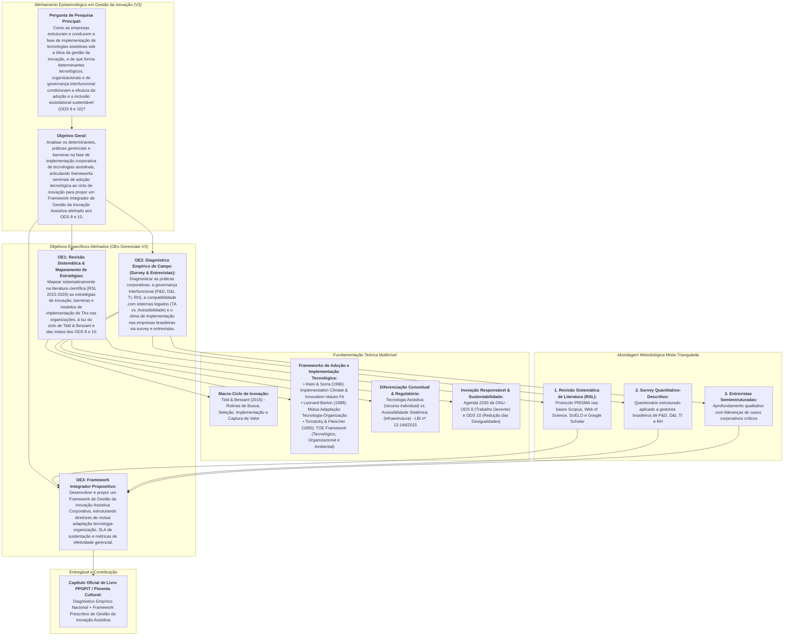

# PROPOSTA ESTRUTURADA DE CAPÍTULO DE LIVRO (GETI 2026 / PPGPIT UNIFESP) – VERSÃO 3.0

**Coletânea Oficial:** *Práticas de Gestão da Inovação Tecnológica* (Série de Livros PPGPIT / Editora Pimenta Cultural & Editora Unitau)  
**Disciplina:** Gestão Estratégica da Inovação (GETI 2026)  
**Instituição:** Universidade Federal de São Paulo (UNIFESP) – Instituto de Ciência e Tecnologia (ICT)  
**Programa:** Programa de Pós-Graduação em Inovação Tecnológica (PPGPIT)  
**Status do Documento:** Versão 3.0 (Consolidada após reunião de alinhamento de 15/10/2026 e incorporação do feedback docente)

---

## 📌 QUADRO EVOLUTIVO DE ATENDIMENTO E INCORPORAÇÃO (V1 ➔ V2 ➔ V3)

| Dimensão Crítica | Devolutiva Docente & Reuniões da Equipe | Solução Consolidada na Versão 3.0 (V3) |
| :--- | :--- | :--- |
| **1. Objeto de Análise: Gestão da Inovação vs. Diagnóstico Sociológico** | Docentes alertaram: *"Cuidado para o artigo ter uma análise de gestão da inovação, não apenas apresentar dados sobre implementação. Mudar o foco do diagnóstico sociológico/trabalhista para a gestão corporativa da inovação"*. | **Foco estrito no nível meso/organizacional (a firma):** A Tecnologia Assistiva (TA) é investigada como inovação sociotécnica interna de processos e postos de trabalho. A inclusão sociolaboral é tratada como o *impacto/output de valor gerado*, amparado pelas diretrizes dos **ODS 8 (Trabalho Decente)** e **ODS 10 (Redução das Desigualdades)**, mas com o núcleo analítico centrado em capacidades organizacionais, governança e rotinas de implementação. |
| **2. Distinção Conceitual: Tecnologia Assistiva vs. Acessibilidade Sistêmica** | Debate de 15/10 (Renata Oliveira): TA e Acessibilidade não são sinônimos. A TA é o recurso centrado no usuário; a acessibilidade é a condição do ambiente, sistemas e processos da firma (LBI nº 13.146/2015). | **Integração Teórico-Operacional:** O insucesso na implementação é explicado exatamente pela dissociação entre esses dois polos: a empresa adquire a TA (ex.: leitor de tela, periférico adaptado), mas falha na acessibilidade de sua infraestrutura tecnológica interna (ERPs legados, portais corporativos, fluxos operacionais). O framework aborda essa interface como eixo de *Mútua Adaptação*. |
| **3. Papel de Tidd & Bessant (2015) e Frameworks de Adoção** | Docentes questionaram: *"O que especificamente vocês irão utilizar do ciclo de Tidd e Bessant? Não me parece a melhor literatura para verificar implementação... aplicar frameworks de adoção de produtos"*. | **Articulação Teórica Multinível:** Tidd & Bessant (2015) é mantido exclusivamente como modelo macro-processual das rotinas corporativas (Busca, Seleção, Implementação e Captura de Valor). Para operacionalizar a microdinâmica da implementação, ancoram-se os frameworks seminais de adoção de tecnologia: **TOE Framework** (Tornatzky & Fleischer, 1990), **Clima de Implementação e Values-Fit** (Klein & Sorra, 1996) e **Mútua Adaptação** (Leonard-Barton, 1988). |
| **4. Desenho Metodológico Empírico: Do IBGE à Triangulação Mista** | Docentes recomendaram: *"Substituir dados genéricos do IBGE por entrevistas com gestores de P&D/D&I e aplicar frameworks de adoção"*. Equipe (Manu/Josué em 15/10) propôs levantamento via formulários (survey) e levantamento de literatura (RSL). | **Abordagem Metodológica Mista Triangulada (MMR):** 1. **Revisão Sistemática da Literatura (RSL):** Mapeamento das estratégias e barreiras de inovação assistiva corporativa (2015–2026); 2. **Pesquisa de Campo via Survey (Formulário Estruturado):** Levantamento quantitativo-descritivo com gestores corporativos brasileiros de P&D, D&I, TI e RH; 3. **Entrevistas Semiestruturadas em Profundidade:** Investigação qualitativa com lideranças-chave para aprofundar episódios críticos de implementação e integração de ERPs. |
| **5. Harmonização do Objetivo Geral e Específicos** | Debate de 15/10 (Manu): Necessidade de harmonizar os OEs com a entrega prática do framework e a investigação empírica contemporânea das estratégias no Brasil. | **Nova Matriz de Objetivos (V3):** Objetivo Geral focado na análise dos determinantes gerenciais e na proposição do framework; 3 OEs claros cobrindo: (1) RSL e mapeamento de estratégias/barreiras via Tidd & Bessant, TOE e ODS 8/10; (2) Diagnóstico empírico (survey + entrevistas) do clima de implementação e acessibilidade sistêmica; (3) Construção e validação do Framework de Gestão da Inovação Assistiva Corporativa. |

---

## IDENTIFICAÇÃO DO TRABALHO E EQUIPE

### Título Oficial do Capítulo (Versão 3.0)
> **Gestão Estratégica da Implementação de Tecnologias Assistivas no Ambiente Corporativo: Uma Abordagem Multinível Ancorada em Frameworks de Adoção Tecnológica e nos ODS 8 e 10**  
> *(Strategic Management of Assistive Technology Implementation in Corporate Environments: A Multilevel Approach Grounded in Technology Adoption Frameworks and SDGs 8 & 10)*

### Equipe de Autores (Discentes e Docentes Orientadores)
* **Discentes (Mestrandos PPGPIT / Turma Quarta-feira):**
  * Josué Jofre Tomaz de Almeida
  * Alexandre Pedroso Fernandes
  * Diana Cortez
  * Emilie Modolo
  * Manuela Souza Lima
  * Renata Andrea de Oliveira
* **Docentes Orientadores Vinculados:**
  * Profª. Drª. Maria Elizete Kunkel (Orientadora / LabBiAT - UNIFESP)
  * Profª. Drª. Míriam Raquel Diniz Zanetti (Orientadora - UNIFESP)
  * Prof. Dr. Carlos Marcelo Gurjão de Godoy (Orientador - UNIFESP)
* **Docentes da Disciplina (Coordenação & Avaliação):**
  * Prof. Dr. Antônio Yukio Ueta
  * Profª. Drª. Iraci de Souza João
  * Prof. Dr. Fábio Luís Falchi de Magalhães

---

## MATRIZ DE AMARRAÇÃO METODOLÓGICA (COERÊNCIA INTERNA V3)

---

# ESBOÇO ESTRUTURADO DO CAPÍTULO CONFORME DIRETRIZES EDITORIAIS

A estrutura do capítulo segue o padrão normativo da série *Práticas de Gestão da Inovação Tecnológica* (até 8.000 palavras, espaçamento 1.5, margens de 2 cm e padronização ABNT).

---

### ELEMENTOS PRÉ-TEXTUAIS

#### RESUMO (VERSÃO 3.0)
A adoção de Tecnologias Assistivas (TA) no ambiente corporativo tem sido historicamente tratada sob uma ótica estritamente jurídica e cartorial de cumprimento da Lei de Cotas, resultando em aquisições fragmentadas que culminam em abandono tecnológico, subutilização e ineficácia na inclusão laboral. Sob a lente da Gestão Estratégica da Inovação, a introdução de TAs constitui uma inovação sociotécnica interna de processos e postos de trabalho que requer rotinas estruturadas de implementação, governança interfuncional e contínua adaptação mútua entre tecnologia e ambiente organizacional. Este estudo tem como objetivo analisar os determinantes, práticas gerenciais e barreiras na fase de implementação corporativa de tecnologias assistivas, desenvolvendo um diagnóstico estruturado à luz de frameworks seminais de adoção tecnológica e propondo um Framework Integrador de Gestão da Inovação Assistiva alinhado às metas dos Objetivos de Desenvolvimento Sustentável (ODS 8 – Trabalho Decente e ODS 10 – Redução das Desigualdades). O referencial teórico situa o macro-ciclo de inovação de Tidd e Bessant (2015) em diálogo com modelos consagrados de implementação: o Framework TOE (Tornatzky & Fleischer, 1990), o modelo de Clima de Implementação e Ajuste Inovação-Valores de Klein e Sorra (1996) e a Teoria da Mútua Adaptação de Leonard-Barton (1988), estabelecendo ainda a distinção epistemológica fundamental entre Tecnologia Assistiva (recurso individual de capacitação) e Acessibilidade Sistêmica (condição da infraestrutura e sistemas corporativos legados, conforme a Lei Brasileira de Inclusão nº 13.146/2015). Metodologicamente, adota-se uma abordagem mista triangulada, composta por: (1) Revisão Sistemática da Literatura (RSL) sobre estratégias de inovação assistiva corporativa; (2) Levantamento de campo empírico (Survey) via questionário estruturado aplicado a gestores brasileiros das áreas de Pesquisa e Desenvolvimento (P&D)/Inovação, Diversidade & Inclusão (D&I), Tecnologia da Informação (TI) e Recursos Humanos (RH); e (3) Entrevistas semiestruturadas em profundidade com lideranças corporativas de casos emblemáticos. Os dados são tratados por estatística descritiva e análise de conteúdo categorial (Bardin, 2016). Os resultados evidenciam que a eficácia da implementação depende decisivamente da superação do hiato entre a aquisição da TA e a acessibilidade dos softwares de gestão (ERPs), da consolidação de um clima organizacional de suporte técnico e da instituição de comitês multidisciplinares de governança da inovação inclusiva. Como principal contribuição, apresenta-se o *Framework de Gestão da Inovação Assistiva Corporativa*, fornecendo diretrizes acionáveis para prospecção, homologação técnica, mútua adaptação e sustentabilidade do ciclo de vida das tecnologias nas organizações.

**Palavras-chave:** Gestão da Inovação; Implementação Tecnológica; Frameworks de Adoção; Tecnologia Assistiva; Acessibilidade Corporativa; ODS 8 e ODS 10.

#### ABSTRACT (VERSION 3.0)
The corporate adoption of Assistive Technologies (AT) has historically been driven by narrow regulatory compliance regarding employment quotas, leading to fragmented purchasing decisions that often result in technological abandonment, underutilization, and ineffective workplace inclusion. Through the perspective of Strategic Innovation Management, introducing AT represents an internal socio-technical process and workplace innovation requiring structured implementation routines, cross-functional governance, and ongoing mutual adaptation between technology and the organizational setting. This study aims to analyze the determinants, managerial practices, and barriers within the corporate implementation phase of assistive technologies, developing a structured diagnosis through technology adoption frameworks and proposing an Integrated Corporate Assistive Innovation Management Framework aligned with the Sustainable Development Goals (SDG 8 – Decent Work and SDG 10 – Reduced Inequalities). The theoretical framework contextualizes Tidd and Bessant's (2015) macro-innovation cycle alongside established implementation models: Tornatzky and Fleischer's (1990) TOE Framework, Klein and Sorra's (1996) Implementation Climate and Innovation-Values Fit model, and Leonard-Barton's (1988) Mutual Adaptation Theory, while establishing the fundamental epistemological distinction between Assistive Technology (individual user-centered resource) and Systemic Accessibility (the condition of corporate legacy IT infrastructure and environments, pursuant to Brazilian Inclusion Law No. 13,146/2015). Methodologically, a triangulated mixed-methods design is employed, combining: (1) a Systematic Literature Review (SLR) on corporate assistive innovation strategies; (2) an empirical field survey using structured questionnaires distributed to Brazilian managers across R&D/Innovation, Diversity & Inclusion (D&I), Information Technology (IT), and Human Resources (HR); and (3) in-depth semi-structured interviews with corporate leaders from landmark cases. Data is processed using descriptive statistics and categorical content analysis (Bardin, 2016). Findings demonstrate that implementation effectiveness critically hinges on bridging the gap between AT procurement and legacy ERP enterprise software accessibility, fostering an organizational climate of technical support, and establishing multidisciplinary inclusive innovation governance committees. As its core contribution, the study delivers the *Corporate Assistive Innovation Management Framework*, providing actionable guidelines for technological scouting, technical co-design, mutual adaptation, and lifecycle sustainability.

**Keywords:** Innovation Management; Technology Implementation; Adoption Frameworks; Assistive Technology; Corporate Accessibility; SDG 8 and SDG 10.

---

### SEÇÃO 1: INTRODUÇÃO (~1.000 palavras)

* **1.1 Contextualização da Gestão da Inovação de Processos Internos:**
  * Distinção entre inovação comercial e inovação organizacional/de processo interno no ambiente de trabalho (Tidd & Bessant, 2015; Pisano, 2015).
  * A Tecnologia Assistiva (TA) como ferramenta catalisadora de inclusão sociolaboral e desempenho produtivo.
* **1.2 O Problema de Pesquisa e a Lacuna na Gestão Organizacional:**
  * O abismo entre cumprimento cartorial da Lei de Cotas e assimilação tecnológica duradoura.
  * O abandono tecnológico como indicador de falha gerencial na implementação (Phillips & Zhao, 1993; Sugawara et al., 2018).
  * O descompasso entre a compra da TA e a inacessibilidade de sistemas legados corporativos (ERPs).
  * O alinhamento estratégico com os ODS 8 (Trabalho Decente) e ODS 10 (Redução das Desigualdades).
* **1.3 Pergunta de Pesquisa Principal:**
  > *Como as empresas estruturam e conduzem a fase de implementação de tecnologias assistivas sob a ótica da gestão da inovação, e de que forma determinantes tecnológicos, organizacionais e de governança interfuncional condicionam a eficácia da adoção e a inclusão sociolaboral sustentável (ODS 8 e 10)?*
* **1.4 Objetivo Geral e Objetivos Específicos (OEs V3):**
  * **Objetivo Geral:** Analisar os determinantes, práticas gerenciais e barreiras na fase de implementação corporativa de tecnologias assistivas, articulando frameworks seminais de adoção tecnológica ao ciclo de inovação para propor um Framework Integrador de Gestão da Inovação Assistiva alinhado aos ODS 8 e 10.
  * **Objetivos Específicos:**
    1. *OE1 (Revisão Sistemática & Mapeamento de Estratégias):* Mapear sistematicamente na literatura científica nacional e internacional (RSL 2015–2026) as estratégias de inovação, barreiras e modelos de implementação de TAs nas organizações, à luz do ciclo de Tidd & Bessant e das metas dos ODS 8 e 10;
    2. *OE2 (Diagnóstico Empírico de Campo):* Diagnosticar as práticas corporativas, a governança interfuncional (P&D, D&I, TI, RH), a compatibilidade com sistemas legados (TA vs. Acessibilidade) e o clima de implementação nas empresas brasileiras via survey estruturado e entrevistas semiestruturadas com gestores;
    3. *OE3 (Framework Integrador Propositivo):* Desenvolver e propor um Framework de Gestão da Inovação Assistiva Corporativa, estruturando diretrizes de mútua adaptação tecnologia-organização, SLA de sustentação e métricas de efetividade gerencial.
* **1.5 Estrutura do Capítulo:** Visão geral da organização textual.

---

### SEÇÃO 2: REVISÃO DE LITERATURA E QUADRO TEÓRICO (~2.200 palavras)

#### 2.1 A Gestão do Processo de Inovação nas Organizações: O Macro-Ciclo de Tidd e Bessant (2015)
* O modelo processual da inovação: Busca (*Search*), Seleção (*Select*), Implementação (*Implement*) e Captura de Valor (*Capture*).
* Justificativa epistemológica: Tidd & Bessant como arcabouço macro de rotinas, complementado por teorias de micro-implementação organizacional.

#### 2.2 Frameworks Seminais de Adoção e Implementação Tecnológica
* **Klein e Sorra (1996):** Eficácia de Implementação, Clima de Implementação (*Implementation Climate*) e Ajuste Inovação-Valores (*Innovation-Values Fit*).
* **Leonard-Barton (1988):** Teoria da Mútua Adaptação (ajuste recíproco tecnologia-organização).
* **Tornatzky e Fleischer (1990) / Baker (2012):** Framework TOE (dimensões Tecnológica, Organizacional e Ambiental).

#### 2.3 Fronteiras Conceituais: Tecnologia Assistiva vs. Acessibilidade Sistêmica
* **Tecnologia Assistiva (TA):** Dispositivo/serviço individual para autonomia funcional (LBI art. 3º, III; Bersch, 2017).
* **Acessibilidade Corporativa/Sistêmica:** Propriedade da infraestrutura, arquitetura de TI e procedimentos da organização (LBI art. 3º, I).
* O cerne da falha gerencial: Adquirir TA sem prover acessibilidade sistêmica nos ERPs e processos.

#### 2.4 Inovação Responsável e os Objetivos de Desenvolvimento Sustentável (ODS 8 e 10)
* ODS 8.5: Trabalho produtivo, decente e equitativo.
* ODS 10.2: Inclusão social, econômica e política.

---

### SEÇÃO 3: METODOLOGIA E DESENHO DA PESQUISA (~1.200 palavras)

* **3.1 Abordagem Metodológica Mista Triangulada (MMR):** Triangulação convergente (Creswell & Creswell, 2018).
* **3.2 Etapa 1 – Revisão Sistemática da Literatura (RSL):** Protocolo PRISMA nas bases Scopus, Web of Science, SciELO e Google Scholar (2015–2026).
* **3.3 Etapa 2 – Survey Estruturado com Gestores Corporativos:**
  * Instrumento com 15 a 18 itens em escala Likert de 5 pontos;
  * 4 perfis executivos: P&D/Inovação, D&I, TI/Sistemas e RH/Ergonomia.
* **3.4 Etapa 3 – Entrevistas Semiestruturadas em Profundidade:** Aprofundamento com 6 a 8 lideranças de casos emblemáticos.
* **3.5 Tratamento de Dados:** Estatística descritiva (survey) e Análise de Conteúdo Temático-Categorial (Bardin, 2016).

---

### SEÇÃO 4: ANÁLISE E DISCUSSÃO DOS RESULTADOS (~2.300 palavras)

* **4.1 Governança Interfuncional e Rotinas Decisórias de Adoção:** De compras reativas a comitês multidisciplinares de inovação inclusiva.
* **4.2 Contexto Tecnológico e a Barreira dos ERPs Legados:** Desafios de integração sistêmica e co-design do posto de trabalho.
* **4.3 Contexto Organizacional, Clima de Implementação e Gestão da Mudança:** Políticas de treinamento sistêmico e alinhamento de valores.
* **4.4 Sustentação do Ciclo de Vida e KPIs de Inovação:** Gestão de SLAs, suporte técnico continuado e transição de cotas para métricas de efetividade.

---

### SEÇÃO 5: FRAMEWORK DE GESTÃO DA INOVAÇÃO ASSISTIVA CORPORATIVA (~1.200 palavras)

* Modelo em 4 fases: (1) Prospecção & Co-Design; (2) Mútua Adaptação & Implementação; (3) Clima de Implementação & Cultura; (4) Sustentação & Métricas de Ciclo de Vida.
* Diretrizes práticas acionáveis para executivos e lideranças corporativas.

---

### SEÇÃO 6: CONSIDERAÇÕES FINAIS (~800 palavras)

* Síntese das contribuições teóricas e práticas, limitações metodológicas e agenda de pesquisas futuras.

---

### REFERÊNCIAS (PADRONIZAÇÃO ABNT NBR 6023)

* Referências seminais completas (Tidd & Bessant, Klein & Sorra, Leonard-Barton, Tornatzky & Fleischer, Bardin, Creswell, Lei nº 13.146/2015, ONU ODS, Bersch, Galvão Filho, Phillips & Zhao, Sugawara et al.).
