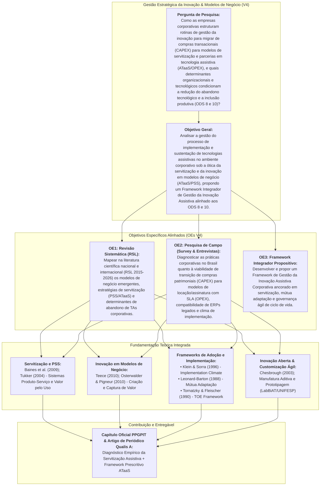

# PROPOSTA ESTRUTURADA DE CAPÍTULO DE LIVRO (GETI 2026 / PPGPIT UNIFESP) – VERSÃO 4.0

**Coletânea Oficial:** *Práticas de Gestão da Inovação Tecnológica* (Série de Livros PPGPIT / Editora Pimenta Cultural & Editora Unitau)  
**Disciplina:** Gestão Estratégica da Inovação (GETI 2026)  
**Instituição:** Universidade Federal de São Paulo (UNIFESP) – Instituto de Ciência e Tecnologia (ICT)  
**Programa:** Programa de Pós-Graduação em Inovação Tecnológica (PPGPIT)  
**Status do Documento:** Versão 4.0 (Consolidada com a Nova Estratégia de Servitização / ATaaS e Evidências da RSL)

---

## 📌 QUADRO EVOLUTIVO DE ATENDIMENTO E INCORPORAÇÃO (V1 ➔ V2 ➔ V3 ➔ V4)

| Dimensão Crítica | Devolutivas Docentes & Alinhamentos da Equipe | Solução Consolidada na Versão 4.0 (V4) |
| :--- | :--- | :--- |
| **1. Objeto de Gestão da Inovação vs. Diagnóstico Sociológico** | Alerta docente: *"Cuidado para o artigo ter uma análise de gestão da inovação... mudar o foco para a gestão corporativa de TA"*. | **Inovação em Modelos de Negócio (Business Model Innovation):** A investigação transcende a compra pontual e analisa a transição para **Servitização** (*Product-Service Systems - PSS*) e **ATaaS (*Assistive Technology as a Service*)**. A inclusão é tratada como geração de valor econômico e social compartilhado (**ODS 8 e ODS 10**). |
| **2. O Paradoxo do Abandono Tecnológico no Trabalho** | Literatura e debates: Altas taxas de abandono (30% a 50%) decorrem da falta de manutenção, obsolescência e incompatibilidade sistêmica de ERPs legados. | **Mudança Paradigmática de CAPEX para OPEX:** Substituição da compra patrimonial estática de hardware/software (CAPEX) por contratação continuada de serviços com **SLA ágil e substituição emergencial (*hot-swap* em 24h)**, desonerando o RH e a TI corporativa. |
| **3. Distinção Conceitual: TA vs. Acessibilidade Sistêmica** | Debate de 15/10 (Renata Oliveira / LBI nº 13.146/2015): TA é o recurso centrado no usuário; Acessibilidade é a infraestrutura sistêmica da firma. | **Integração no Modelo de Negócio:** Modelos de *Managed Services* e BPO Inclusivo onde parceiros especializados realizam tanto a parametrização individual da TA quanto a adequação das interfaces de ERPs e intranets corporativas. |
| **4. Evidências Empíricas da RSL Simplificada (2015–2026)** | Triagem de 54 artigos com 19 PDFs integrais baixados na pasta `artigos/` do projeto. | **Articulação com Literatura de Fronteira:** Incorporação de estudos seminais sobre transição de dependência assistencial para modelos de mercado (*From Aid Dependency to Market Transformation*, 2026), combate ao abandono (*From Abandonment to Adoption*, 2026) e sustentabilidade comercial (*Business Models for Sustainable Commercialisation*, 2021). |
| **5. Metodologia Mista Triangulada (MMR)** | Exigência docente de substituir o IBGE por dados empíricos primários. | **Triangulação Consolidada:** (1) RSL automatizada com repositório local de PDFs; (2) Survey estruturado em 5 blocos com gestores corporativos brasileiros; (3) Entrevistas em profundidade com lideranças de casos emblemáticos (ex.: Embraer, Hand Talk, Sistema S). |

---

## IDENTIFICAÇÃO DO TRABALHO E EQUIPE

### Título Oficial do Capítulo (Versão 4.0)
> **Inovação em Modelos de Negócio e Servitização na Gestão de Tecnologias Assistivas Corporativas: Uma Abordagem Baseada em ATaaS, Frameworks de Adoção e nos ODS 8 e 10**  
> *(Business Model Innovation and Servitization in Corporate Assistive Technology Management: An Approach Based on ATaaS, Adoption Frameworks, and SDGs 8 & 10)*

### Equipe de Autores (Discentes e Docentes Orientadores)
* **Discentes (Mestrandos PPGPIT / Turma Quarta-feira):**
  * Josué Jofre Tomaz de Almeida
  * Alexandre Pedroso Fernandes
  * Diana Cortez
  * Emilie Modolo
  * Manuela Souza Lima
  * Renata Andrea de Oliveira
* **Docentes Orientadores Vinculados:**
  * Profª. Drª. Maria Elizete Kunkel (Orientadora / LabBiAT - UNIFESP)
  * Profª. Drª. Míriam Raquel Diniz Zanetti (Orientadora - UNIFESP)
  * Prof. Dr. Carlos Marcelo Gurjão de Godoy (Orientador - UNIFESP)
* **Docentes da Disciplina (Coordenação & Tutoria):**
  * Prof. Dr. Antônio Yukio Ueta
  * Profª. Drª. Iraci de Souza João
  * Prof. Dr. Fábio Luís Falchi de Magalhães

---

## MATRIZ DE COERÊNCIA METODOLÓGICA (VERSÃO 4.0)

---

### ELEMENTOS PRÉ-TEXTUAIS

#### RESUMO (VERSÃO 4.0)
Historicamente, a adoção de Tecnologias Assistivas (TA) no ambiente corporativo brasileiro tem se limitado a compras transacionais e pontuais de equipamentos de prateleira, impulsionadas exclusivamente pelo cumprimento cartorial da Lei de Cotas. Esse modelo estático de alocação de capital (CAPEX) frequentemente resulta em subutilização, custos imprevistos de manutenção e elevados índices de abandono tecnológico quando o trabalhador muda de atividade ou o dispositivo apresenta defeito. Sob a lente da Gestão Estratégica da Inovação, este estudo investiga a transição de paradigma para modelos de **Servitização** (*Product-Service Systems - PSS*) e **Tecnologia Assistiva como Serviço (*Assistive Technology as a Service - ATaaS*)**, nos quais a organização contrata a autonomia funcional, o suporte contínuo e a compatibilidade sistêmica como despesa operacional (*OPEX*), garantindo acordos de nível de serviço (SLA) ágeis e substituição emergencial (*hot-swap* em 24h). O objetivo geral é analisar a gestão do processo de implementação corporativa de tecnologias assistivas sob a ótica da servitização e da inovação em modelos de negócio, propondo um Framework Integrador de Gestão da Inovação Assistiva alinhado às metas dos Objetivos de Desenvolvimento Sustentável (ODS 8 – Trabalho Decente e ODS 10 – Redução das Desigualdades). O referencial teórico articula a literatura de servitização e modelos de negócio (Baines et al., 2009; Tukker, 2004; Teece, 2010) aos frameworks seminais de implementação tecnológica: o Modelo TOE (Tornatzky & Fleischer, 1990), o Clima de Implementação (Klein & Sorra, 1996) e a Teoria da Mútua Adaptação (Leonard-Barton, 1988), incorporando a distinção epistemológica entre Tecnologia Assistiva (recurso individual) e Acessibilidade Sistêmica (infraestrutura e ERPs corporativos legados, conforme a Lei nº 13.146/2015). Metodologicamente, adota-se um desenho misto triangulado (MMR) composto por: (1) Revisão Sistemática da Literatura (RSL) simplificada sobre servitização e novos modelos de negócio em TA (2015–2026), com triagem e repositório de artigos integrais; (2) Levantamento empírico de campo (Survey) com gestores corporativos brasileiros de P&D/Inovação, Diversidade & Inclusão (D&I), Tecnologia da Informação (TI) e Recursos Humanos (RH); e (3) Entrevistas em profundidade com lideranças de casos emblemáticos de inovação inclusiva. Os achados evidenciam que a servitização atua como o principal mecanismo para mitigar o abandono tecnológico, transferindo a complexidade de manutenção para parceiros especializados e viabilizando a personalização ágil via impressão 3D e interfaces adaptativas. Como principal contribuição, apresenta-se o *Framework de Gestão da Inovação Assistiva Corporativa Baseado em ATaaS*, fornecendo um roteiro acionável para tomada de decisão entre comprar versus contratar como serviço, governança interfuncional e sustentabilidade de ciclo de vida.

**Palavras-chave:** Gestão da Inovação; Modelos de Negócio; Servitização; ATaaS; Tecnologia Assistiva; Acessibilidade Corporativa; ODS 8 e ODS 10.

#### ABSTRACT (VERSION 4.0)
Historically, corporate adoption of Assistive Technologies (AT) within Brazilian organizations has been constrained to transactional, one-off purchases of off-the-shelf equipment, exclusively motivated by legal quota compliance. This static capital expenditure (CAPEX) paradigm frequently leads to underutilization, unpredictable repair costs, and acute technological abandonment rates when job routines change or technical failures occur. Grounded in Strategic Innovation Management, this study explores the paradigm shift toward **Servitization** (*Product-Service Systems - PSS*) and **Assistive Technology as a Service (ATaaS)**, wherein organizations procure workplace functional autonomy, technical interoperability, and continuous support through operational expenditures (*OPEX*), backed by rapid service level agreements (SLAs) and emergency hot-swap replacements within 24 hours. The primary objective is to analyze corporate assistive technology implementation management through the lenses of servitization and business model innovation, delivering an Integrated Assistive Innovation Management Framework aligned with the UN Sustainable Development Goals (SDG 8 – Decent Work and SDG 10 – Reduced Inequalities). The theoretical background integrates servitization and business model theories (Baines et al., 2009; Tukker, 2004; Teece, 2010) with seminal technology adoption frameworks: the TOE Framework (Tornatzky & Fleischer, 1990), Implementation Climate and Values Fit (Klein & Sorra, 1996), and Mutual Adaptation Theory (Leonard-Barton, 1988), while incorporating the legal-epistemological boundary between individual Assistive Technology and corporate Systemic Accessibility (legacy ERPs and workplace infrastructure, pursuant to Brazilian Inclusion Law No. 13,146/2015). Methodologically, a triangulated mixed-methods research design is employed, comprising: (1) a targeted Systematic Literature Review (SLR 2015–2026) supported by automated indexing and local repository management; (2) an empirical field survey applied to Brazilian managers across R&D/Innovation, Diversity & Inclusion (D&I), Information Technology (IT), and Human Resources (HR); and (3) in-depth semi-structured interviews with corporate leaders from landmark inclusive business cases. Findings demonstrate that servitization and managed services act as key mechanisms to mitigate technological abandonment, offloading maintenance friction to specialized open innovation partners and enabling agile 3D-printed customization. As its core contribution, this study delivers the *ATaaS-Based Corporate Assistive Innovation Management Framework*, establishing practical decision-making criteria between purchasing versus service-oriented procurement, cross-functional governance, and life-cycle sustainability.

**Keywords:** Innovation Management; Business Models; Servitization; ATaaS; Assistive Technology; Corporate Accessibility; SDG 8 and SDG 10.

---

### SEÇÃO 1: INTRODUÇÃO (~1.000 palavras)
* Contextualização da inovação interna de processos e postos de trabalho;
* A falência do modelo de compra patrimonial (CAPEX) e as taxas de abandono de 30% a 50%;
* A emergência da Servitização (ATaaS) e parcerias em Inovação Aberta;
* A delimitação da Pergunta de Pesquisa e dos 3 Objetivos Específicos;
* Alinhamento direto às metas dos ODS 8 (Trabalho Decente) e ODS 10 (Redução das Desigualdades).

### SEÇÃO 2: REVISÃO DE LITERATURA E QUADRO TEÓRICO (~2.300 palavras)
* **2.1 A Gestão do Processo de Inovação nas Organizações (Tidd & Bessant, 2015):** Rotinas macro de Busca, Seleção, Implementação e Captura de Valor.
* **2.2 Servitização, PSS e Inovação em Modelos de Negócio:**
  * Baines et al. (2009) e Tukker (2004): Transição para sistemas produto-serviço orientados ao resultado e ao uso;
  * Teece (2010): Arquitetura de criação e captura de valor em modelos de negócio corporativos;
  * ATaaS (*Assistive Technology as a Service*): Locação com SLA, comodato e manutenção continuada como fator inibidor de abandono tecnológico.
* **2.3 Frameworks Seminais de Implementação Tecnológica na Firma:**
  * Klein & Sorra (1996): Clima de Implementação e Ajuste Inovação-Valores (*Values Fit*);
  * Leonard-Barton (1988): A Teoria da Mútua Adaptação (ajuste entre a tecnologia e os procedimentos da empresa);
  * Tornatzky & Fleischer (1990): Framework TOE (dimensões Tecnológica, Organizacional e Ambiental).
* **2.4 Fronteira Conceitual: TA vs. Acessibilidade Sistêmica (Lei nº 13.146/2015):** A TA como recurso centrado na pessoa e a acessibilidade como propriedade da infraestrutura e dos ERPs corporativos legados (SAP, TOTVS).
* **2.5 Customização Ágil, Manufatura Aditiva e Open Innovation:** A prototipagem rápida e impressão 3D paramétrica (LabBiAT/UNIFESP) e parcerias com startups para viabilizar postos de trabalho adaptados.

### SEÇÃO 3: METODOLOGIA E DESENHO DA PESQUISA (~1.200 palavras)
* **3.1 Abordagem Metodológica Mista Triangulada (MMR);**
* **3.2 Etapa 1 – RSL Simplificada com Gestão Automatizada de Repositório:**
  * Protocolo nas bases Scopus, OpenAlex e Europe PMC;
  * 54 obras mapeadas e 19 artigos com texto integral em PDF catalogados no painel de controle interativo (`controle_artigos.html`);
* **3.3 Etapa 2 – Survey Estruturado com Gestores Corporativos:**
  * 15 a 18 itens Likert cobrindo Perfil, Governança, Decisão CAPEX vs. OPEX/ATaaS, Compatibilidade de ERPs e Clima de Implementação;
* **3.4 Etapa 3 – Entrevistas Semiestruturadas em Profundidade:**
  * Casos corporativos (TI, D&I, Inovação Aberta);
* **3.5 Tratamento de Dados:** Estatística descritiva e Análise de Conteúdo Temático-Categorial (Bardin, 2016).

### SEÇÃO 4: ANÁLISE E DISCUSSÃO DOS RESULTADOS (~2.300 palavras)
* **4.1 Governança Corporativa e a Decisão CAPEX vs. OPEX:** Análise dos custos de transação e barreiras orçamentárias na aquisição de TAs;
* **4.2 O Papel dos Parceiros de Open Innovation e Managed Services:** Como startups e consultorias desoneram a firma da complexidade de suporte técnico e treinamento;
* **4.3 A Barreira dos ERPs Legados e a Mútua Adaptação:** O conflito entre softwares assistivos e sistemas corporativos sem padrões WCAG/W3C;
* **4.4 Clima de Implementação, Cultura e Combate ao Abandono Tecnológico:** O impacto do treinamento de equipes e do suporte com SLA imediato (*hot-swap*).

### SEÇÃO 5: FRAMEWORK DE GESTÃO DA INOVAÇÃO ASSISTIVA BASEADO EM ATaaS (~1.200 palavras)
* Apresentação do modelo em 4 etapas:
  1. *Prospecção & Análise de Decisão (Make, Buy or Servitize / CIF);*
  2. *Mútua Adaptação & Acessibilidade Sistêmica (Integração técnica e co-design);*
  3. *Clima de Implementação & Engajamento Cultural (Treinamento e patrocínio);*
  4. *Sustentação do Ciclo de Vida Baseada em SLA (Hot-swap, atualização e KPIs ESG/ODS).*

### SEÇÃO 6: CONSIDERAÇÕES FINAIS E REFERÊNCIAS
* Síntese das contribuições teóricas (integração de Servitização/PSS à Tecnologia Assistiva corporativa) e gerenciais (roteiro prático para executivos);
* Referências normatizadas pela ABNT NBR 6023 (incluindo Baines, Tukker, Teece, Scherer, Sugawara, Leonard-Barton, Klein & Sorra, Tornatzky & Fleischer, e artigos mapeados na RSL).
