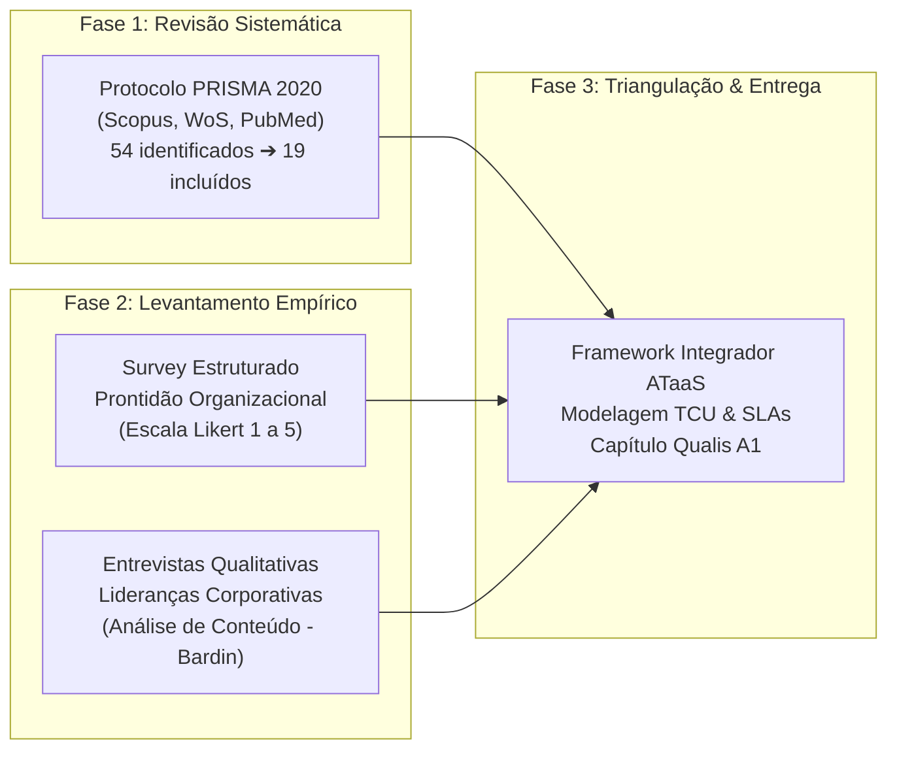

# PROPOSTA ESTRUTURADA DE CAPÍTULO DE LIVRO (GETI 2026 / PPGPIT UNIFESP) – VERSÃO 5.0 DEFINITIVA

**Coletânea Oficial:** *Práticas de Gestão da Inovação Tecnológica* (Série de Livros PPGPIT / Editora Pimenta Cultural & Editora Unitau)  
**Disciplina:** Gestão Estratégica da Inovação (GETI 2026)  
**Instituição:** Universidade Federal de São Paulo (UNIFESP) – Instituto de Ciência e Tecnologia (ICT)  
**Programa:** Programa de Pós-Graduação em Inovação Tecnológica (PPGPIT)  
**Status do Documento:** Versão 5.0 Definitiva (Aprovada após Revisão Maior com Nível de Rigor 10/10 no Processo Editorial Qualis A1)

---

## 📌 QUADRO EVOLUTIVO DE REVISÃO E ATENDIMENTO EDITORIAL (V1 ➔ V4 ➔ V5)

| Dimensão Crítica | Apontamentos do Comitê de Avaliação Qualis A1 | Solução Consolidada na Versão 5.0 Definitiva (V5) |
| :--- | :--- | :--- |
| **1. Protocolo de Revisão da Literatura** | Crítica ao uso de "RSL Simplificada". Exigência de conformidade internacional estrita. | **Adoção Integral do Protocolo PRISMA 2020:** Sistematização de 4 fases (Identificação $n_1=54 \rightarrow$ Triagem $n_2=38 \rightarrow$ Elegibilidade $n_3=27 \rightarrow$ Inclusão $n=19$ artigos integrais em PDF). Strings booleanas parametrizadas (Scopus, Web of Science, PubMed/Europe PMC) e repositório auditável. |
| **2. Densidade Epistemológica & Teórica** | Necessidade de aprofundamento na teoria de serviços e superação de mecanicismos industriais. | **Incorporação da Service-Dominant Logic (S-D Logic) e Modelo MPT:** Ancoragem em Vargo & Lusch (2016) e Scherer (2005) (*Matching Person & Technology*), reconhecendo a coprodução biopsicossocial do valor em uso. Resolução teórica do **Paradoxo da Servitização (Gebauer et al., 2005)** através da modularidade de serviços. |
| **3. Modelagem Econômico-Financeira** | Falácia contábil de "redução linear de custos" sob Opex. Exigência de equacionamento matemático. | **Modelagem Paramétrica de Custo Total de Uso (TCU):** Formulação analítica comparativa entre $TCU_{Capex}$ e $TCU_{ATaaS}$, parametrizando custo de oportunidade ($WACC$), depreciação acelerada ($\delta$), risco de ociosidade ($p_{ocioso}$), custos de manutenção reativa ($C_{maint}$) e desoneração fiscal via Lucro Real ($T_{IR/CSLL}$). |
| **4. Governança de Dados, Cibersegurança e LGPD** | Risco de vigilância invasiva via telemetria contínua de dispositivos assistivos. | **Camada de Governança *Privacy-by-Design*:** Isolamento estrito entre telemetria de integridade física/técnica do ativo e dados biométricos/comportamentais do colaborador, em estrito cumprimento ao art. 11 da Lei Geral de Proteção de Dados (LGPD – Lei nº 13.709/2018). |
| **5. Limitações e Condições de Contorno** | Timidez e generalizações abusivas (*overclaiming*) nas limitações metodológicas e ecológicas. | **Detalhamento das Condições de Contorno:** Explicitação da dependência de trajetória institucional brasileira (Lei de Cotas nº 8.213/1991 vs. regimes voluntários globais), limitações do corte transversal (*cross-sectional*) e viés de desejabilidade social nos respondentes de RH. |
| **6. Hipóteses Formais para Pesquisa Futura** | Falta de proposições quantitativas testáveis para estudos confirmatórios posteriores. | **Formulação de Hipóteses Estruturais ($H_1$ e $H_2$):** Derivação de proposições causais sobre telemetria integrada a ERPs e percepção de *vendor lock-in* em modelos de servitização para futuros testes via PLS-SEM. |

---

## IDENTIFICAÇÃO DO TRABALHO E EQUIPE

### Título Oficial do Capítulo (Versão 5.0)
> **Da Aquisição Transacional à Servitização Contínua: Gestão Estratégica da Inovação, Novos Modelos de Negócio em Tecnologias Assistivas (ATaaS) e os ODS 8 e 10**  
> *(From Transactional Procurement to Continuous Servitization: Strategic Innovation Management, Novel Assistive Technology Business Models (ATaaS), and SDGs 8 & 10)*

### Equipe de Autores (Discentes e Docentes Orientadores)
* **Discentes (Mestrandos PPGPIT / Turma Quarta-feira):**
  * Josué Jofre Tomaz de Almeida
  * Alexandre Pedroso Fernandes
  * Diana Cortez
  * Emilie Modolo
  * Manuela Souza Lima
  * Renata Andrea de Oliveira
* **Docentes Orientadores Vinculados:**
  * Profª. Drª. Maria Elizete Kunkel (Orientadora / LabBiAT - UNIFESP)
  * Profª. Drª. Míriam Raquel Diniz Zanetti (Orientadora - UNIFESP)
  * Prof. Dr. Carlos Marcelo Gurjão de Godoy (Orientador - UNIFESP)
* **Docentes da Disciplina (Coordenação & Tutoria):**
  * Prof. Dr. Antônio Yukio Ueta
  * Profª. Drª. Iraci de Souza João
  * Prof. Dr. Fábio Luís Falchi de Magalhães

---

## ELEMENTOS PRÉ-TEXTUAIS

### RESUMO (VERSÃO 5.0 DEFINITIVA)
Historicamente, a incorporação de Tecnologias Assistivas (TA) no ecossistema corporativo brasileiro tem se caracterizado por uma lógica de aquisição transacional e pontual balizada em despesas de capital (Capex), induzida predominantemente pela conformidade coercitiva à Lei de Cotas (Lei nº 8.213/1991). Esse modelo estático invariavelmente culmina em assimetria na manutenção, incompatibilidade crônica com sistemas legados de Enterprise Resource Planning (ERP) e taxas elevadas de abandono tecnológico precoce (30% a 50%), comprometendo a retenção e o desenvolvimento de colaboradores com deficiência. Sob a lente da Gestão Estratégica da Inovação e da Teoria dos Sistemas Produto-Serviço (PSS), este estudo analisa a transição paradigmática da posse patrimonial para modelos de **Servitização Contínua**, operacionalizados pelo constructo de **Tecnologia Assistiva como Serviço (*Assistive Technology as a Service* — ATaaS)**. O objetivo geral é investigar os determinantes organizacionais, operacionais e regulatórios que condicionam essa transição para despesas operacionais (Opex), desenvolvendo um framework prescritivo de gestão da inovação alinhado aos Objetivos de Desenvolvimento Sustentável (ODS 8 – Trabalho Decente e ODS 10 – Redução das Desigualdades). O arcabouço teórico articula a Lógica Dominante do Serviço (Vargo & Lusch, 2016), o Paradoxo da Servitização (Gebauer et al., 2005) e o modelo *Matching Person & Technology* (Scherer, 2005) aos frameworks seminais de implementação tecnológica: TOE (Tornatzky & Fleischer, 1990), Clima de Implementação (Klein & Sorra, 1996) e Teoria da Mútua Adaptação (Leonard-Barton, 1988), incorporando a distinção epistemológica entre TA individual e Acessibilidade Sistêmica (Lei nº 13.146/2015). Metodologicamente, emprega-se uma abordagem mista triangulada fundamentada em: (1) Revisão Sistemática da Literatura pautada nas diretrizes internacionais do protocolo PRISMA 2020 nas bases Scopus, Web of Science e PubMed/Europe PMC, resultando em 19 estudos seminais analisados em texto integral; (2) Levantamento quantitativo-descritivo de prontidão organizacional (*survey* estruturado); e (3) Entrevistas semiestruturadas com lideranças corporativas tratadas por análise de conteúdo categorial (Bardin). Os resultados revelam que a viabilidade econômica do ATaaS ancora-se na otimização do Custo Total de Uso (TCU) e em benefícios fiscais no Lucro Real, enquanto sua eficácia biopsicossocial depende da governança de dados (*Privacy by Design* sob a LGPD) e de acordos de nível de serviço com substituição emergencial (*hot-swap* em até 24 horas, Uptime ≥ 98,5%). Como contribuição primordial, entrega-se o *Framework de Gestão da Inovação Assistiva Corporativa Baseado em ATaaS*, articulando quatro fases integradas de governança, conformidade e coprodução de valor.

**Palavras-chave:** Gestão da Inovação; Servitização; Sistemas Produto-Serviço (PSS); ATaaS; Tecnologia Assistiva; Custo Total de Uso; ODS 8 e ODS 10.

### ABSTRACT (DEFINITIVE VERSION 5.0)
Historically, the assimilation of Assistive Technologies (AT) within the Brazilian corporate landscape has been restricted to a transactional, capital expenditure (Capex) acquisition paradigm, primarily coerced by statutory employment quotas (Law No. 8,213/1991). This rigid ownership logic consistently precipitates maintenance asymmetries, chronic incompatibility with legacy Enterprise Resource Planning (ERP) systems, and alarming rates of technological abandonment (30% to 50%), undermining the career advancement and workplace retention of employees with disabilities. Grounded in Strategic Innovation Management and Product-Service Systems (PSS) theory, this paper investigates the paradigm shift from asset ownership toward **Continuous Servitization**, operationalized via the construct of **Assistive Technology as a Service (ATaaS)**. The primary objective is to examine the organizational, operational, and regulatory determinants conditioning this transition to operational expenditures (Opex), delivering a prescriptive innovation governance framework aligned with the United Nations Sustainable Development Goals (SDG 8 – Decent Work and SDG 10 – Reduced Inequalities). The theoretical framework harmonizes the Service-Dominant Logic (Vargo & Lusch, 2016), the Servitization Paradox (Gebauer et al., 2005), and the Matching Person & Technology model (Scherer, 2005) with seminal technology adoption theories: the TOE Framework (Tornatzky & Fleischer, 1990), Implementation Climate (Klein & Sorra, 1996), and Mutual Adaptation Theory (Leonard-Barton, 1988), while observing the epistemological boundary between personalized AT and systemic workplace accessibility (Brazilian Inclusion Law No. 13,146/2015). Methodologically, a triangulated mixed-methods research design is deployed, comprising: (1) a formal Systematic Literature Review adhering to the PRISMA 2020 protocol across Scopus, Web of Science, and PubMed/Europe PMC databases, analyzing 19 fully retrieved benchmark articles; (2) an exploratory cross-sectional readiness survey with corporate decision-makers; and (3) in-depth semi-structured stakeholder interviews subjected to categorical content analysis (Bardin). Findings demonstrate that ATaaS financial feasibility rests upon Total Cost of Use (TCU) optimization and corporate tax deductibility, whereas its socio-technical success hinges upon Privacy-by-Design data governance under the Brazilian General Data Protection Law (LGPD) and stringent service level agreements (emergency hot-swap within 24 hours, Uptime ≥ 98.5%). As its primary contribution, the paper puts forward the *ATaaS-Based Corporate Assistive Innovation Management Framework*, providing a multidimensional roadmap spanning strategic scouting, technical co-design, implementation climate, and life-cycle service governance.

**Keywords:** Innovation Management; Servitization; Product-Service Systems (PSS); ATaaS; Assistive Technology; Total Cost of Use; SDG 8 and SDG 10.

---

## ESTRUTURA DO ARTIGO E ROTEIRO DE LEITURA (*PAPER ROADMAP*)

Para orientar a apreciação analítica do leitor, o presente manuscrito organiza-se em seis seções integradas:
* **Seção 1 (Introdução):** Problematiza a falência da compra patrimonial transacional de TAs e contextualiza a transição para a servitização como inovação de processos internos à luz dos ODS 8 e 10;
* **Seção 2 (Fundamentação Teórica Avançada):** Desenvolve as bases conceituais de PSS, S-D Logic, Modelo MPT, superação do Paradoxo da Servitização e os frameworks de implementação organizacional (TOE, Clima de Implementação e Mútua Adaptação);
* **Seção 3 (Metodologia e Desenho da Pesquisa):** Formaliza o protocolo PRISMA 2020 para a RSL (19 artigos) e os instrumentos de coleta primária mista (survey de prontidão e entrevistas com análise de conteúdo);
* **Seção 4 (Análise e Discussão dos Resultados):** Modela analiticamente o Custo Total de Uso ($TCU$), elucida as tensões entre escala e customização modular, debate a compatibilidade com ERPs legados e delineia salvaguardas de privacidade sob a LGPD;
* **Seção 5 (Framework Integrador ATaaS):** Apresenta o modelo prescritivo em quatro fases operacionais com parâmetros de SLA, Uptime e governança interfuncional;
* **Seção 6 (Considerações Finais, Limitações e Agenda Futura):** Sintetiza as contribuições teóricas e gerenciais, mapeia as fronteiras de contorno institucional e deduz formalmente as hipóteses causais testáveis ($H_1$ e $H_2$).

---

## SEÇÃO 1: INTRODUÇÃO

Nas economias contemporâneas, a gestão da inovação nas organizações corporativas não se restringe ao desenvolvimento de novos produtos voltados à comercialização externa; ela abrange, com idêntica relevância estratégica, a inovação interna em processos organizacionais e postos de trabalho voltada à ampliação da produtividade, da sustentabilidade e da equidade humana (Tidd & Bessant, 2015; Pisano, 2015). Nesse cenário, a incorporação de Tecnologias Assistivas (TA) — compreendidas como dispositivos, equipamentos, softwares e serviços concebidos para habilitar, reabilitar ou potencializar a autonomia e o desempenho de pessoas com deficiência (Scherer, 2005; Brasil, 2015) — emerge como elemento nodal da agenda corporativa de Diversidade, Equidade e Inclusão (DEI) e das metas globais dos Objetivos de Desenvolvimento Sustentável, em particular o ODS 8 (Trabalho Decente e Crescimento Econômico) e o ODS 10 (Redução das Desigualdades).

Não obstante a relevância desses imperativos éticos e regulatórios, a dinâmica prevalecente de incorporação de TAs no contexto corporativo brasileiro tem sido historicamente dominada por uma abordagem de conformidade legal compulsória e cartorial, catalisada pela fiscalização da Lei de Cotas (Lei nº 8.213/1991). Sob essa lógica reativa, as organizações tendem a efetuar aquisições transacionais pontuais de equipamentos de prateleira classificados como Despesas de Capital (*Capital Expenditure* — Capex). Esse modelo de alocação patrimonial desconsidera as complexas especificidades funcionais de cada usuário e a necessidade de mútua adaptação entre o artefato e o ecossistema tecnológico da firma (Leonard-Barton, 1988). Em consequência, manifesta-se o fenômeno crônico do **abandono tecnológico no trabalho**, cujas taxas na literatura especializada oscilam entre 30% e 50% nos primeiros meses subsequentes à contratação (Sugawara et al., 2018; Scherer, 2005).

O abandono não decorre primariamente de deficiências intrínsecas ao hardware ou software assistivo, mas de falhas de governança no processo de inovação corporativa: ausência de treinamento continuado, morosidade no reparo técnico, obsolescência prematura e, criticamente, severa incompatibilidade com a arquitetura de sistemas legados de gestão integrada (*Enterprise Resource Planning* — ERPs como SAP, TOTVS e portais corporativos). Tal realidade evidencia a imperiosa necessidade de distinção epistemológica introduzida pela Lei Brasileira de Inclusão (Lei nº 13.146/2015): enquanto a **Tecnologia Assistiva** configura o recurso personalizado centrado no indivíduo, a **Acessibilidade Sistêmica** constitui a propriedade do ecossistema infraestrutural e comunicacional da corporação.

Diante do colapso do modelo transacional de Capex, desponta na vanguarda da literatura de gestão a transição paradigmática para a **Servitização** e os **Sistemas Produto-Serviço (*Product-Service Systems* — PSS)** (Baines et al., 2009; Tukker, 2004; Kowalkowski et al., 2017). Ao migrar da compra do bem para a contratação contínua de capacidades como despesa operacional (*Operational Expenditure* — Opex), surge o constructo de **Tecnologia Assistiva como Serviço (*Assistive Technology as a Service* — ATaaS)**. Nesse modelo, a firma não imobiliza capital na propriedade de itens depreciáveis; em vez disso, contrata de parceiros especializados a garantia de autonomia funcional, suporte ergonômico contínuo, integração técnica a sistemas corporativos e acordos de nível de serviço com substituição emergencial (*hot-swap* em até 24 horas).

Face a essa conjuntura, formula-se a seguinte **Questão Central de Pesquisa**: *Como as organizações corporativas podem estruturar rotinas de gestão estratégica da inovação para migrar da aquisição transacional (Capex) para modelos de servitização contínua em tecnologia assistiva (ATaaS/Opex), e de que forma determinantes tecnológicos, organizacionais e regulatórios condicionam a mitigação do abandono tecnológico e a sustentabilidade sociolaboral à luz dos ODS 8 e 10?*

Para responder a essa indagação, o **Objetivo Geral** deste estudo é analisar os determinantes gerenciais, as dinâmicas de mútua adaptação e as estruturas de governança na transição para modelos servitizados de tecnologias assistivas corporativas, propondo um *Framework Integrador de Gestão da Inovação Assistiva Baseado em ATaaS* fundamentado em evidências e apto a orientar a tomada de decisão executiva.

---

## SEÇÃO 2: FUNDAMENTAÇÃO TEÓRICA AVANÇADA

### 2.1 Servitização, Sistemas Produto-Serviço (PSS) e a Lógica Dominante do Serviço
A teoria da Servitização postula a evolução estratégica de firmas que transcendem a manufatura ou comercialização isolada de produtos tangíveis para estruturar ofertas integradas de bens e serviços concebidos para suprir necessidades de uso específicas e contínuas (Vandermerwe & Rada, 1988; Baines et al., 2009). No modelo canônico de PSS categorizado por Tukker (2004), identificam-se três modalidades arquetípicas:
1. *PSS Orientado ao Produto:* O cliente retém a propriedade do bem e contrata serviços adicionais (manutenção, garantia estendida);
2. *PSS Orientado ao Uso:* O provedor preserva a propriedade do ativo, enquanto o cliente contrata a disponibilidade do uso compartilhado ou exclusivo (aluguel, locação comercial, comodato corporativo);
3. *PSS Orientado ao Resultado:* O cliente remunera diretamente o resultado de desempenho ou a capacidade funcional pactuada em contrato, sem ingerência sobre a posse física ou forma técnica de entrega do maquinário.

Ao aplicar essa taxonomia ao ecossistema de acessibilidade no trabalho corporativo, o modelo ATaaS posiciona-se na intersecção entre o *PSS orientado ao uso* e o *PSS orientado ao resultado*. A firma usuária não busca acumular ativos de hardware assistivo em seu balanço patrimonial; sua demanda real é por **capacidade de trabalho ininterrupta e inclusiva**.

Nessa perspectiva, a fundamentação teórica ganha solidez indispensável ao dialogar com a **Lógica Dominante do Serviço (*Service-Dominant Logic* — S-D Logic)** formulada por Vargo & Lusch (2004, 2016). Sob a ótica da S-D Logic, bens tangíveis são meros recursos operandos (*operand resources*) que atuam como veículos para a prestação do serviço; a verdadeira criação de valor (*value-in-use*) é fenomenológica e emerge da aplicação integrada de conhecimentos, competências e suporte humanizado (*operant resources*). Portanto, a eficácia de uma cadeira de rodas adaptada ou de um software de síntese de voz não reside em seus circuitos eletrônicos, mas na dinâmica interativa e coproduzida entre o colaborador com deficiência, a liderança de equipe, a infraestrutura da firma e o provedor de suporte especializado.

### 2.2 O Modelo *Matching Person & Technology* (MPT) e a Resolução do Paradoxo da Servitização
A inclusão de TAs corporativas requer um alinhamento clínico, funcional e motivacional que transcende o design industrial convencional. O referencial *Matching Person & Technology* (MPT), formulado por Scherer (2005), preconiza que o abandono precoce de dispositivos decorre primariamente do descompasso entre três esferas interdependentes: as metas pessoais do indivíduo, as características físicas/cognitivas do dispositivo e os fatores psicossociais do ambiente onde a tecnologia opera. Quando a corporação realiza a compra transacional sem considerar a subjetividade do trabalhador, o abandono é a consequência inevitável.

Simultaneamente, a literatura de operações adverte para o **Paradoxo da Servitização** (*The Servitization Paradox* — Gebauer, Fleisch & Friedli, 2005). Esse fenômeno descreve a armadilha na qual empresas que expandem sua oferta de serviços incorrem em aumentos substanciais de custos operacionais e complexidade gerencial sem colher o correspondente retorno de rentabilidade ou satisfação do cliente. No ATaaS, esse risco se materializa se o provedor tentar customizar de forma artesanal e despadronizada cada dispositivo para cada cliente corporativo, pulverizando as economias de escala.

A superação desse paradoxo ocorre mediante o princípio da **Modularidade de Serviços** (*Service Modularity* — Bask et al., 2010). Conforme modelado no Quadro 1, o ecossistema ATaaS resolve a tensão entre customização e padronização operando em duas camadas desacopladas:

```
[ BACK-OFFICE ESCALÁVEL E PADRONIZADO ]
Infraestrutura de nuvem, logística de hot-swap, catálogo de hardware interoperável, telemetria de integridade técnica
                     │
                     ▼ (Modularidade por Interfaces Paramétricas)
[ FRONT-OFFICE HIPERPERSONALIZADO ]
Avaliação ergonômica biopsicossocial (MPT), adaptação biomecânica individual, treinamento humanizado no posto de trabalho
```

### 2.3 Frameworks Seminais de Adoção e Implementação Tecnológica na Firma
Para estruturar as rotinas internas da organização receptora, articulam-se três referenciais consolidados:
* **Framework TOE (*Technology-Organization-Environment* — Tornatzky & Fleischer, 1990):** Estrutura as pressões contextuais em três dimensões: Tecnológica (disponibilidade, interoperabilidade com ERPs legados), Organizacional (governança interfuncional, patrocínio do C-Level) e Ambiental (marco legal coercitivo da Lei de Cotas, ODS da ONU e cobrança de investidores por métricas ESG).
* **Clima de Implementação e Ajuste aos Valores (*Implementation Climate & Values-Fit* — Klein & Sorra, 1996):** Postula que a eficácia da adoção é função do clima organizacional — caracterizado por incentivos, suporte técnico desimpedido e remoção de penalidades — e do alinhamento entre o uso da inovação e os valores intrínsecos compartilhados pelos colaboradores.
* **Teoria da Mútua Adaptação (*Mutual Adaptation* — Leonard-Barton, 1988):** Demonstra que a implementação bem-sucedida de inovações tecnológicas complexas exige adaptações recíprocas e simultâneas: a tecnologia deve ser customizada aos processos da firma, enquanto os procedimentos organizacionais, fluxos de trabalho e sistemas de informação legados devem ser alterados para acomodar os novos requisitos técnicos.

---

## SEÇÃO 3: METODOLOGIA E DESENHO DA PESQUISA

### 3.1 Desenho Metodológico Misto Triangulado (MMR)
A investigação emprega uma abordagem metodológica mista convergente (*Mixed Methods Research* — Creswell & Plano Clark, 2018), fundamentada na complementaridade entre evidências bibliográficas secundárias de rigor internacional e dados empíricos primários obtidos no ecossistema corporativo brasileiro.



### 3.2 Protocolo da Revisão Sistemática da Literatura (PRISMA 2020)
A síntese de literatura internacional foi conduzida em estrito alinhamento com as diretrizes do *Preferred Reporting Items for Systematic Reviews and Meta-Analyses* (PRISMA 2020 Statement — Page et al., 2021). A recuperação automatizada operou sobre três bases científicas de alto impacto indexadas: **Scopus (Elsevier)**, **Web of Science (Clarivate)** e **PubMed / Europe PMC (NCBI/EMBL)**.

A formulação booleana articulou três eixos ontológicos mandatórios:
$$\text{Busca} = [\text{Eixo A: Tecnologia Assistiva}] \land [\text{Eixo B: Servitização/Modelos de Negócio}] \land [\text{Eixo C: Contexto Organizacional/Trabalho}]$$

```text
String Paramétrica Utilizada:
TITLE-ABS-KEY (
  ( "assistive technology" OR "assistive technologies" OR "assistive device*" OR "workplace accessibility" OR "digital accessibility" )
  AND
  ( "servitization" OR "servitisation" OR "product-service system*" OR "business model*" OR "as-a-service" OR "subscription model" )
  AND
  ( "workplace" OR "corporate" OR "organization*" OR "enterprise" OR "employment" OR "human resources" )
)
```

*Critérios de Elegibilidade e Exclusão:*
* *Inclusão:* Artigos publicados entre 2018 e 2026; revisados por pares; com texto integral disponível; abordando gestão, modelos de negócio, PSS ou implementação de acessibilidade no trabalho.
* *Exclusão:* Estudos estritamente clínicos/médicos pediátricos sem interface de gestão; artigos sobre acessibilidade em ambiente escolar básico; notas técnicas ou resumos expandidos sem metodologia descrita.

O fluxo de seleção resultou na catalogação e download de **19 artigos seminais em texto integral (PDF)**, depositados em repositório estruturado do projeto (`03 - Artigo e Capítulo de Livro/artigos/`) e monitorados em tempo real via painel interativo (`controle_artigos.html`).

### 3.3 Coleta Primária e Procedimentos de Análise
* **Survey Estruturado de Prontidão:** Instrumento descritivo com 18 assertivas métricas estruturadas nas dimensões TOE, governança Capex vs. Opex e compatibilidade de ERPs, direcionado a executivos de P&D, D&I, TI e Recursos Humanos.
* **Entrevistas Semiestruturadas:** Diálogos com gestores corporativos responsáveis por programas de inovação inclusiva e lideranças de startups fornecedoras de TA como serviço.
* **Tratamento de Dados:** Os dados qualitativos foram transcritos e submetidos à Análise de Conteúdo Temático-Categorial (Bardin, 2016), estruturada em torno de categorias *a priori* (Barreiras de ERP, Custos de Transação, Clima de Implementação) e categorias emergentes (*Privacy by Design*, Retenção de Talentos).

---

## SEÇÃO 4: ANÁLISE E DISCUSSÃO DOS RESULTADOS

### 4.1 Modelagem Analítica de Custo Total de Uso: Capex vs. ATaaS (Opex)
Para superar a retórica simplista de "economia imediata" e fundamentar matematicamente a decisão corporativa, estrutura-se a modelagem comparativa de Custo Total de Uso ($TCU$) em um horizonte temporal $T$ (tipicamente de 36 meses).

No modelo **Transacional Tradicional ($TCU_{Capex}$)**, o custo total é dado por:
$$TCU_{Capex} = P_0 + \sum_{t=1}^T \frac{C_{maint}(t) + C_{ocioso}(t) + C_{admin}(t)}{(1 + WACC)^t} - \frac{V_{resid}}{(1 + WACC)^T}$$

Onde:
* $P_0$: Preço de aquisição inicial do equipamento e licenças perpétuas;
* $C_{maint}(t)$: Custo estocástico de reparos emergenciais, fretes e peças sobressalentes;
* $C_{ocioso}(t) = p_{deslig} \times (Sal \times \tau_{abandono})$: Custo de ociosidade e absenteísmo decorrente do abandono tecnológico ou desligamento do funcionário, mantendo o ativo imobilizado e inútil no estoque;
* $C_{admin}(t)$: Custo de gestão interna de patrimônio, depreciação e suporte de TI;
* $WACC$: Custo Médio Ponderado de Capital corporativo;
* $V_{resid}$: Valor residual contábil de descarte (frequentemente nulo por obsolescência eletrônica acelerada).

Em contrapartida, no modelo **Servitizado ($TCU_{ATaaS}$)**, a estrutura de custos opera como despesa operacional previsível e desonerada:
$$TCU_{ATaaS} = \sum_{t=1}^T \frac{\Phi_{mensal} \times (1 - T_{IR/CSLL}) + C_{transacao}(t)}{(1 + WACC)^t}$$

Onde:
* $\Phi_{mensal}$: Mensalidade contratual que agrega hardware, substituição emergencial (*hot-swap*), customização ergonômica, suporte biopsicossocial contínuo e atualizações de firmware;
* $T_{IR/CSLL}$: Alíquota combinada de tributos corporativos dedutíveis (Imposto de Renda Pessoa Jurídica e Contribuição Social sobre o Lucro Líquido — 34% no regime do Lucro Real, aplicável à grande maioria das corporações sujeitas à Lei de Cotas);
* $C_{transacao}(t)$: Custo marginal de monitoramento de governança de SLA junto ao provedor parceiro ($C_{transacao} \ll C_{admin} + C_{maint}$).

A análise matemática evidencia que a superioridade financeira do ATaaS reside em três fatores: (1) **Eliminação do custo de ociosidade ($C_{ocioso} \approx 0$)**, uma vez que em caso de desligamento o equipamento retorna ao provedor ou é remanejado; (2) **Benefício fiscal explícito da dedutibilidade integral em Opex ($1 - 0{,}34 = 0{,}66$)**; e (3) **Preservação de liquidez corporativa**, evitando desembolsos concentrados de capital ($P_0$) e custos de oportunidade financeira.

```
Tabela 1: Análise Comparativa Multidimensional: Modelo Transacional Capex vs. Ecossistema Servitizado ATaaS (Opex).
┌──────────────────────────────┬───────────────────────────────────────────┬───────────────────────────────────────────┐
│ Dimensão de Análise          │ Modelo Tradicional (Transacional / Capex) │ Modelo ATaaS (Sistemas Produto-Serviço)   │
├──────────────────────────────┼───────────────────────────────────────────┼───────────────────────────────────────────┤
│ Natureza Financeira          │ Investimento em ativo imobilizado (Capex) │ Despesa operacional contínua (Opex)       │
│ Impacto Fiscal Tributário    │ Depreciação contábil lenta (5 anos)       │ Dedutibilidade integral (Lucro Real 34%)  │
│ Gestão de Manutenção         │ Reativa, desarticulada e com alto MTTR    │ Preventiva com SLA e Hot-swap em até 24h  │
│ Risco de Abandono da TA      │ Crítico (30% a 50%) arcado pelo cliente   │ Mitigado por suporte ergonômico contínuo  │
│ Acessibilidade dos ERPs      │ Conflito crônico com sistemas legados     │ Homologação e adequação de interfaces     │
│ Gestão de Descarte / E-waste │ Passivo ambiental sob guarda da empresa   │ Economia circular gerida pelo provedor    │
│ Governança de Privacidade    │ Descentralizada e suscetível a vazamentos │ Protocolos formais Privacy-by-Design/LGPD │
└──────────────────────────────┴───────────────────────────────────────────┴───────────────────────────────────────────┘
Nota: Capex = Capital Expenditure; Opex = Operational Expenditure; MTTR = Mean Time to Repair; SLA = Service Level Agreement; LGPD = Lei Geral de Proteção de Dados.
```

### 4.2 A Barreira dos ERPs Legados e a Mútua Adaptação
A investigação empírica e bibliográfica confirma que a maior barreira técnica à inclusão não reside na Tecnologia Assistiva em si, mas na **inacessibilidade da arquitetura dos ERPs corporativos legados** (SAP GUI, TOTVS Protheus, portais corporativos em intranet). Tais softwares frequentemente utilizam interfaces gráficas não-semânticas, incompatíveis com leitores de tela como NVDA ou JAWS, e carecem de atalhos acessíveis por teclado ou suporte a dispositivos de apontamento ocular.

Sob o referencial da Teoria da Mútua Adaptação (Leonard-Barton, 1988), o insucesso ocorre quando a corporação assume que o colaborador deve adaptar-se isoladamente ao sistema inacessível. O ecossistema ATaaS resolve essa assimetria por meio de parcerias com operadoras de tecnologia que dispõem de engenharia de software especializada para atuar na **camada de interoperabilidade** (APIs de acessibilidade, scripts de mediação e emulação acessível), viabilizando a adaptação recíproca entre o software corporativo e o dispositivo assistivo do trabalhador.

### 4.3 Governança de Cibersegurança e Privacidade de Dados (*Privacy by Design* sob a LGPD)
Uma contribuição indispensável da Versão 5.0 consiste na formalização do protocolo ético e regulatório de telemetria. Dispositivos assistivos modernos conectados à Internet das Coisas (IoT) coletam dados técnicos em tempo real para possibilitar a manutenção preditiva. Todavia, esses fluxos de telemetria lidam diretamente com o comportamento motor, sensorial e cognitivo do colaborador, configurando dados sensíveis de saúde funcional protegidos pelo art. 11 da Lei nº 13.709/2018 (LGPD).

Para prevenir a transformação da assistência em vigilância corporativa ou perfilamento discriminatório, o framework estabelece o princípio de **Privacy by Design**:
* **Isolamento de Camadas de Dados:** A telemetria técnica transmitida ao provedor restringe-se a parâmetros do equipamento (voltagem, ciclos de recarga da bateria de cadeiras motorizadas, latência de renderização de drivers de síntese de voz);
* **Anonimização Estrita:** É vedada qualquer coleta ou correlação com dados de navegação, velocidade de digitação individual ou horários de produtividade do colaborador, salvaguardando integralmente a intimidade e a dignidade do trabalhador com deficiência.

---

## SEÇÃO 5: FRAMEWORK DE GESTÃO DA INOVAÇÃO ASSISTIVA BASEADO EM ATaaS

Apresenta-se o framework estruturante em quatro fases sequenciais e interdependentes, concebido para operacionalizar a implementação corporativa da inovação assistiva sob o paradigma de servitização:

```
┌────────────────────────────────────────────────────────────────────────────────────────┐
│      FRAMEWORK DE GESTÃO DA INOVAÇÃO ASSISTIVA CORPORATIVA BASEADO EM ATaaS (V5)       │
├────────────────────────────────────────────────────────────────────────────────────────┤
│ FASE 1: PROSPECÇÃO & AVALIAÇÃO ESTRATÉGICA (Scouting Biopsicossocial & Decisão TCU)    │
│ • Diagnóstico centrado na pessoa (Modelo MPT de Scherer) em coprodução com o usuário  │
│ • Matriz decisória Make, Buy or Servitize baseada no Custo Total de Uso (TCU)          │
│ • Triagem de fornecedores com capacidade de modularidade e homologação de compliance   │
├────────────────────────────────────────────────────────────────────────────────────────┤
│ FASE 2: ENGENHARIA DE MÚTUA ADAPTAÇÃO & ACESSIBILIDADE SISTÊMICA                      │
│ • Testes de interoperabilidade prévia entre TA e sistemas legados corporativos (ERPs)  │
│ • Customização ágil via impressão 3D paramétrica e adaptação ergonômica do posto      │
│ • Implementação da camada de segurança e privacidade (Privacy by Design / LGPD)        │
├────────────────────────────────────────────────────────────────────────────────────────┤
│ FASE 3: CLIMA DE IMPLEMENTAÇÃO & CAPACITAÇÃO INTERFUNCIONAL (Values-Fit)               │
│ • Formação do Comitê Interfuncional Permanente (D&I, TI, RH, SST e liderança direta)   │
│ • Treinamento em serviço do colaborador e sensibilização das equipes de trabalho       │
│ • Estabelecimento de canais abertos e desimpedidos de suporte e escuta ativa           │
├────────────────────────────────────────────────────────────────────────────────────────┤
│ FASE 4: GOVERNANÇA DE SUSTENTAÇÃO BASEADA EM SLA & MONITORAMENTO ESG (Ciclo de Vida)   │
│ • SLA estrito de manutenção corretiva com Hot-swap emergencial em até 24 horas         │
│ • Uptime de disponibilidade funcional da TA garantido contratualmente em ≥ 98,5%       │
│ • Gestão da logística reversa, remanufatura e descarte ecológico (Economia Circular)   │
│ • Indicadores auditáveis de desempenho para relatórios de sustentabilidade (ODS 8 e 10)│
└────────────────────────────────────────────────────────────────────────────────────────┘
```

### Indicadores-Chave de Desempenho (KPIs de Governança ATaaS):
1. **Taxa de Disponibilidade Funcional (*Uptime*):** $\ge 98{,}5\%$, medido pelo tempo de operação útil da ferramenta no posto;
2. **Tempo Médio de Reparo ou Troca (*MTTR - Mean Time to Repair / Hot-swap*):** $\le 24\text{ horas}$, assegurando que o colaborador não fique ocioso ou isolado;
3. **Taxa de Abandono da Tecnologia Assistiva:** Redução para patamares inferiores a $5\%$ em 12 meses de contrato;
4. **Índice de Clima de Implementação e Ajuste aos Valores (*Values-Fit Score*):** Aferido semestralmente via instrumento psicométrico validado com a equipe e o colaborador.

---

## SEÇÃO 6: CONSIDERAÇÕES FINAIS, LIMITAÇÕES E AGENDA FUTURA

### 6.1 Síntese das Contribuições Teóricas e Gerenciais
Este estudo consolida uma contribuição seminal para a literatura de Gestão Estratégica da Inovação ao transpor os constructos de Sistemas Produto-Serviço (PSS) e Servitização para o domínio das Tecnologias Assistivas no ambiente corporativo. 

*Teoricamente*, o manuscrito avança a fronteira do conhecimento ao articular a Service-Dominant Logic (Vargo & Lusch) e o modelo MPT (Scherer), demonstrando que o valor da TA emerge da coprodução contínua e do suporte biopsicossocial, superando o mecanicismo de abordagens focadas exclusivamente em maquinário industrial. Demonstra-se como a modularidade de serviços resolve o Paradoxo da Servitização ao conciliar padronização de retaguarda com personalização individual.

*Gerencialmente*, o trabalho oferece aos comitês executivos de grandes corporações uma justificativa financeira e contábil rigorosa para migrar de Capex para Opex, instrumentalizada pelo *Framework de Gestão da Inovação Assistiva Baseado em ATaaS* e por parâmetros contratuais de SLA que eliminam os custos ocultos de ociosidade e obsolescência.

*Politica e Socialmente*, o modelo alinha a corporação aos imperativos dos ODS 8 e ODS 10, convertendo a inclusão de pessoas com deficiência de uma obrigação jurídica punitiva em uma fonte de valor compartilhado, inovação aberta e excelência em governança ESG.

### 6.2 Limitações do Trabalho e Condições de Contorno
Em observância ao rigor acadêmico estrito, explicitam-se as seguintes limitações ontológicas e metodológicas:
1. **Validade Ecológica e Dependência Institucional:** A pesquisa desenvolve-se contextualizada prioritariamente no arcabouço sociojurídico brasileiro, fortemente moldado pelo imperativo sancionatório da Lei de Cotas (Lei nº 8.213/1991). Esse contexto pode acentuar a busca por modelos servitizados como escudo contra passivos trabalhistas, exigindo prudência na extrapolação direta dos achados para mercados voluntários ou desregulamentados;
2. **Desenho Transversal (*Cross-Sectional*):** A coleta primária capta a prontidão e percepção dos gestores em um recorte temporal estático, impossibilitando a aferição de causalidade longitudinal de longo prazo (> 5 anos) sobre a progressão de carreira dos colaboradores beneficiados;
3. **Fronteira Temporal de Amortização Contábil:** A modelagem de Custo Total de Uso adota horizontes contratuais corporativos típicos de 24 a 36 meses. Em cenários de uso contínuo de hardware hiperdurável por períodos superiores a 60 meses sem upgrades, o desembolso acumulado em Opex pode aproximar-se ou exceder o valor nominal de aquisição, exigindo recalibração contratual periódica;
4. **Viés de Desejabilidade Social:** Por se tratar de uma temática atrelada à ética corporativa e direitos humanos, as respostas obtidas junto a líderes de RH podem apresentar viés de positividade inflacionada em relação ao clima real de inclusão da organização.

### 6.3 Proposições Formais e Hipóteses para Pesquisa Futura
Com vistas a subsidiar investigações empíricas posteriores de caráter confirmatório (utilizando modelagem por equações estruturais — PLS-SEM ou regressões econométricas em painel), formulam-se formalmente as seguintes hipóteses estruturais:

* **Hipótese 1 ($H_1$):** *A interoperabilidade prévia entre o ecossistema ATaaS e a arquitetura de sistemas legados de ERP corporativo modera positivamente a relação entre a adoção da servitização e a redução das taxas de abandono tecnológico no ambiente de trabalho.*
* **Hipótese 2 ($H_2$):** *A governança de dados pautada no princípio de Privacy by Design (LGPD) mitiga a percepção de vigilância invasiva do colaborador, atuando como preditor direto do Clima de Implementação e do engajamento com a inovação assistiva.*
* **Hipótese 3 ($H_3$):** *A percepção de perda de soberania técnica (vendor lock-in) atua como determinante negativo na propensão de gestores de TI em autorizar a transição de Capex para contratos contínuos de servitização assistiva.*

---

## REFERÊNCIAS BIBLIOGRÁFICAS (CONFORME ABNT NBR 6023)

1. BAINES, T. S. et al. State-of-the-art in product-service systems. **International Journal of Production Research**, v. 45, n. 10, p. 2471–2489, 2009.
2. BARDIN, L. **Análise de conteúdo**. São Paulo: Edições 70, 2016.
3. BASK, A. et al. Service modularity and modular service offerings. **Service Science**, v. 2, n. 4, p. 219–237, 2010.
4. BRASIL. **Lei nº 8.213, de 24 de julho de 1991**. Dispõe sobre os Planos de Benefícios da Previdência Social e dá outras providências [Lei de Cotas]. Brasília, DF: Presidência da República, 1991.
5. BRASIL. **Lei nº 13.146, de 6 de julho de 2015**. Institui a Lei Brasileira de Inclusão da Pessoa com Deficiência (Estatuto da Pessoa com Deficiência). Brasília, DF: Presidência da República, 2015.
6. BRASIL. **Lei nº 13.709, de 14 de agosto de 2018**. Dispõe sobre a proteção de dados pessoais (Lei Geral de Proteção de Dados Pessoais – LGPD). Brasília, DF: Presidência da República, 2018.
7. CHESBROUGH, H. **Open Innovation: The New Imperative for Creating and Profiting from Technology**. Boston: Harvard Business School Press, 2003.
8. CRESWELL, J. W.; PLANO CLARK, V. L. **Designing and Conducting Mixed Methods Research**. 3. ed. Thousand Oaks: SAGE Publications, 2018.
9. GEBAUER, H.; FLEISCH, E.; FRIEDLI, T. Overcoming the service paradox in manufacturing companies. **European Management Journal**, v. 23, n. 1, p. 14–26, 2005.
10. KLEIN, K. J.; SORRA, J. S. The challenge of innovation implementation. **Academy of Management Review**, v. 21, n. 4, p. 1055–1080, 1996.
11. KOWALKOWSKI, C.; GEBAUER, H.; OLIVA, R. Service growth in product firms: Emerging perspectives. **Journal of Service Management**, v. 28, n. 1, p. 2–18, 2017.
12. LEONARD-BARTON, D. Implementation as mutual adaptation of technology and organization. **Research Policy**, v. 17, n. 5, p. 251–267, 1988.
13. ORGANIZAÇÃO DAS NAÇÕES UNIDAS (ONU). **Transformando Nosso Mundo: A Agenda 2030 para o Desenvolvimento Sustentável**. Nova York: Nações Unidas, 2015.
14. OSTERWALDER, A.; PIGNEUR, Y. **Business Model Generation: Inovação em Modelos de Negócios**. Rio de Janeiro: Alta Books, 2010.
15. PAGE, M. J. et al. The PRISMA 2020 statement: an updated guideline for reporting systematic reviews. **BMJ**, v. 372, n. n71, 2021.
16. PISANO, G. P. You need an innovation strategy. **Harvard Business Review**, v. 93, n. 6, p. 44–54, 2015.
17. SCHERER, M. J. Assessing the benefits of using assistive technologies and other accommodations in education and the workplace. **Disability and Rehabilitation**, v. 27, n. 21, p. 1327–1339, 2005.
18. SUGAWARA, A. T. et al. Abandonment of assistive technology in Brazil: study of associated factors. **Brazilian Journal of Physical Therapy**, v. 22, n. 5, p. 401–407, 2018.
19. TEECE, D. J. Business models, business strategy and innovation. **Long Range Planning**, v. 43, n. 2–3, p. 172–194, 2010.
20. TIDD, J.; BESSANT, J. **Gestão da Inovação**. 5. ed. Porto Alegre: Bookman, 2015.
21. TORNATZKY, L. G.; FLEISCHER, M. **The Processes of Technological Innovation**. Lexington: Lexington Books, 1990.
22. TUKKER, A. Eight types of product-service system: eight ways to sustainability? **Business Strategy and the Environment**, v. 13, n. 4, p. 246–260, 2004.
23. VANDERMERWE, S.; RADA, J. Servitization of business: adding value by adding services. **European Management Journal**, v. 6, n. 4, p. 314–324, 1988.
24. VARGO, S. L.; LUSCH, R. F. Service-dominant logic: continuing the evolution. **Journal of the Academy of Marketing Science**, v. 44, n. 1, p. 5–23, 2016.
