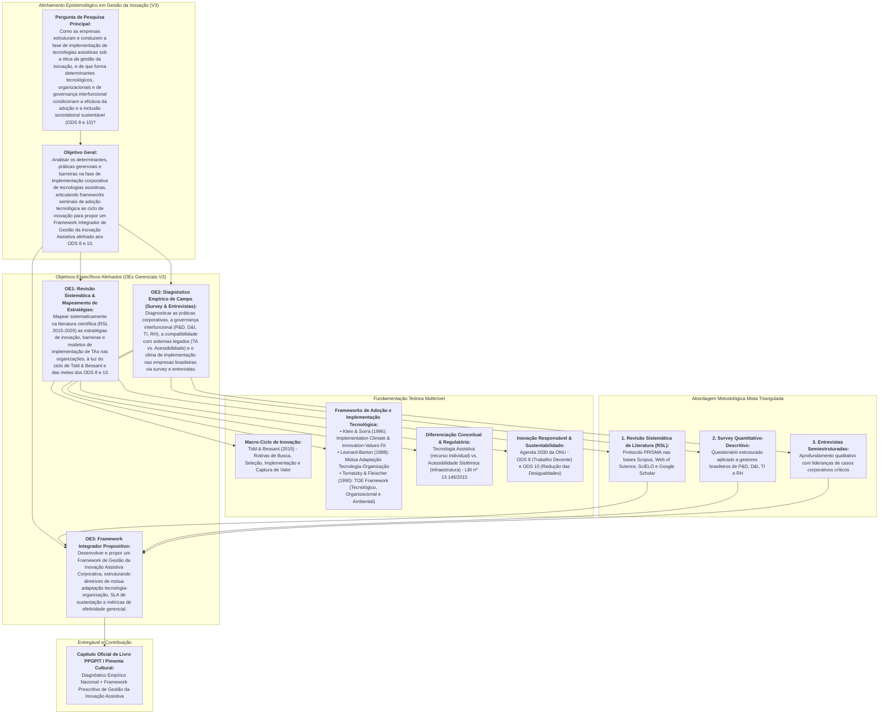
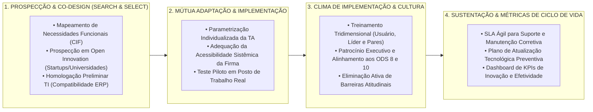

# PROPOSTA ESTRUTURADA DE CAPÍTULO DE LIVRO (GETI 2026 / PPGPIT UNIFESP) – VERSÃO 3.0

**Coletânea Oficial:** *Práticas de Gestão da Inovação Tecnológica* (Série de Livros PPGPIT / Editora Pimenta Cultural & Editora Unitau)  
**Disciplina:** Gestão Estratégica da Inovação (GETI 2026)  
**Instituição:** Universidade Federal de São Paulo (UNIFESP) – Instituto de Ciência e Tecnologia (ICT)  
**Programa:** Programa de Pós-Graduação em Inovação Tecnológica (PPGPIT)  
**Status do Documento:** Versão 3.0 (Consolidada após reunião de alinhamento de 15/10/2026 e incorporação do feedback docente)

---

## 📌 QUADRO EVOLUTIVO DE ATENDIMENTO E INCORPORAÇÃO (V1 ➔ V2 ➔ V3)

| Dimensão Crítica | Devolutiva Docente & Reuniões da Equipe | Solução Consolidada na Versão 3.0 (V3) |
| :--- | :--- | :--- |
| **1. Objeto de Análise: Gestão da Inovação vs. Diagnóstico Sociológico** | Docentes alertaram: *"Cuidado para o artigo ter uma análise de gestão da inovação, não apenas apresentar dados sobre implementação. Mudar o foco do diagnóstico sociológico/trabalhista para a gestão corporativa da inovação"*. | **Foco estrito no nível meso/organizacional (a firma):** A Tecnologia Assistiva (TA) é investigada como inovação sociotécnica interna de processos e postos de trabalho. A inclusão sociolaboral é tratada como o *impacto/output de valor gerado*, amparado pelas diretrizes dos **ODS 8 (Trabalho Decente)** e **ODS 10 (Redução das Desigualdades)**, mas com o núcleo analítico centrado em capacidades organizacionais, governança e rotinas de implementação. |
| **2. Distinção Conceitual: Tecnologia Assistiva vs. Acessibilidade Sistêmica** | Debate de 15/10 (Renata Oliveira): TA e Acessibilidade não são sinônimos. A TA é o recurso centrado no usuário; a acessibilidade é a condição do ambiente, sistemas e processos da firma (LBI nº 13.146/2015). | **Integração Teórico-Operacional:** O insucesso na implementação é explicado exatamente pela dissociação entre esses dois polos: a empresa adquire a TA (ex.: leitor de tela, periférico adaptado), mas falha na acessibilidade de sua infraestrutura tecnológica interna (ERPs legados, portais corporativos, fluxos operacionais). O framework aborda essa interface como eixo de *Mútua Adaptação*. |
| **3. Papel de Tidd & Bessant (2015) e Frameworks de Adoção** | Docentes questionaram: *"O que especificamente vocês irão utilizar do ciclo de Tidd e Bessant? Não me parece a melhor literatura para verificar implementação... aplicar frameworks de adoção de produtos"*. | **Articulação Teórica Multinível:** Tidd & Bessant (2015) é mantido exclusivamente como modelo macro-processual das rotinas corporativas (Busca, Seleção, Implementação e Captura de Valor). Para operacionalizar a microdinâmica da implementação, ancoram-se os frameworks seminais de adoção de tecnologia: **TOE Framework** (Tornatzky & Fleischer, 1990), **Clima de Implementação e Values-Fit** (Klein & Sorra, 1996) e **Mútua Adaptação** (Leonard-Barton, 1988). |
| **4. Desenho Metodológico Empírico: Do IBGE à Triangulação Mista** | Docentes recomendaram: *"Substituir dados genéricos do IBGE por entrevistas com gestores de P&D/D&I e aplicar frameworks de adoção"*. Equipe (Manu/Josué em 15/10) propôs levantamento via formulários (survey) e levantamento de literatura (RSL). | **Abordagem Metodológica Mista Triangulada (MMR):** 1. **Revisão Sistemática da Literatura (RSL):** Mapeamento das estratégias e barreiras de inovação assistiva corporativa (2015–2026); 2. **Pesquisa de Campo via Survey (Formulário Estruturado):** Levantamento quantitativo-descritivo com gestores corporativos brasileiros de P&D, D&I, TI e RH; 3. **Entrevistas Semiestruturadas em Profundidade:** Investigação qualitativa com lideranças-chave para aprofundar episódios críticos de implementação e integração de ERPs. |
| **5. Harmonização do Objetivo Geral e Específicos** | Debate de 15/10 (Manu): Necessidade de harmonizar os OEs com a entrega prática do framework e a investigação empírica contemporânea das estratégias no Brasil. | **Nova Matriz de Objetivos (V3):** Objetivo Geral focado na análise dos determinantes gerenciais e na proposição do framework; 3 OEs claros cobrindo: (1) RSL e mapeamento de estratégias/barreiras via Tidd & Bessant, TOE e ODS 8/10; (2) Diagnóstico empírico (survey + entrevistas) do clima de implementação e acessibilidade sistêmica; (3) Construção e validação do Framework de Gestão da Inovação Assistiva Corporativa. |

---

## IDENTIFICAÇÃO DO TRABALHO E EQUIPE

### Título Oficial do Capítulo (Versão 3.0)
> **Gestão Estratégica da Implementação de Tecnologias Assistivas no Ambiente Corporativo: Uma Abordagem Multinível Ancorada em Frameworks de Adoção Tecnológica e nos ODS 8 e 10**  
> *(Strategic Management of Assistive Technology Implementation in Corporate Environments: A Multilevel Approach Grounded in Technology Adoption Frameworks and SDGs 8 & 10)*

### Equipe de Autores (Discentes e Docentes Orientadores)
* **Discentes (Mestrandos PPGPIT / Turma Quarta-feira):**
  * Josué Jofre Tomaz de Almeida
  * Alexandre Pedroso Fernandes
  * Diana Cortez
  * Emilie Modolo
  * Manuela Souza Lima
  * Renata Andrea de Oliveira
* **Docentes Orientadores Vinculados:**
  * Profª. Drª. Maria Elizete Kunkel (Orientadora / LabBiAT - UNIFESP)
  * Profª. Drª. Míriam Raquel Diniz Zanetti (Orientadora - UNIFESP)
  * Prof. Dr. Carlos Marcelo Gurjão de Godoy (Orientador - UNIFESP)
* **Docentes da Disciplina (Coordenação & Avaliação):**
  * Prof. Dr. Antônio Yukio Ueta
  * Profª. Drª. Iraci de Souza João
  * Prof. Dr. Fábio Luís Falchi de Magalhães

---

## MATRIZ DE AMARRAÇÃO METODOLÓGICA (COERÊNCIA INTERNA V3)

---

# ESBOÇO ESTRUTURADO DO CAPÍTULO CONFORME DIRETRIZES EDITORIAIS

A estrutura do capítulo segue o padrão normativo da série *Práticas de Gestão da Inovação Tecnológica* (até 8.000 palavras, espaçamento 1.5, margens de 2 cm e padronização ABNT).

---

### ELEMENTOS PRÉ-TEXTUAIS

#### RESUMO (VERSÃO 3.0)
A adoção de Tecnologias Assistivas (TA) no ambiente corporativo tem sido historicamente tratada sob uma ótica estritamente jurídica e cartorial de cumprimento da Lei de Cotas, resultando em aquisições fragmentadas que culminam em abandono tecnológico, subutilização e ineficácia na inclusão laboral. Sob a lente da Gestão Estratégica da Inovação, a introdução de TAs constitui uma inovação sociotécnica interna de processos e postos de trabalho que requer rotinas estruturadas de implementação, governança interfuncional e contínua adaptação mútua entre tecnologia e ambiente organizacional. Este estudo tem como objetivo analisar os determinantes, práticas gerenciais e barreiras na fase de implementação corporativa de tecnologias assistivas, desenvolvendo um diagnóstico estruturado à luz de frameworks seminais de adoção tecnológica e propondo um Framework Integrador de Gestão da Inovação Assistiva alinhado às metas dos Objetivos de Desenvolvimento Sustentável (ODS 8 – Trabalho Decente e ODS 10 – Redução das Desigualdades). O referencial teórico situa o macro-ciclo de inovação de Tidd e Bessant (2015) em diálogo com modelos consagrados de implementação: o Framework TOE (Tornatzky & Fleischer, 1990), o modelo de Clima de Implementação e Ajuste Inovação-Valores de Klein e Sorra (1996) e a Teoria da Mútua Adaptação de Leonard-Barton (1988), estabelecendo ainda a distinção epistemológica fundamental entre Tecnologia Assistiva (recurso individual de capacitação) e Acessibilidade Sistêmica (condição da infraestrutura e sistemas corporativos legados, conforme a Lei Brasileira de Inclusão nº 13.146/2015). Metodologicamente, adota-se uma abordagem mista triangulada, composta por: (1) Revisão Sistemática da Literatura (RSL) sobre estratégias de inovação assistiva corporativa; (2) Levantamento de campo empírico (Survey) via questionário estruturado aplicado a gestores brasileiros das áreas de Pesquisa e Desenvolvimento (P&D)/Inovação, Diversidade & Inclusão (D&I), Tecnologia da Informação (TI) e Recursos Humanos (RH); e (3) Entrevistas semiestruturadas em profundidade com lideranças corporativas de casos emblemáticos. Os dados são tratados por estatística descritiva e análise de conteúdo categorial (Bardin, 2016). Os resultados evidenciam que a eficácia da implementação depende decisivamente da superação do hiato entre a aquisição da TA e a acessibilidade dos softwares de gestão (ERPs), da consolidação de um clima organizacional de suporte técnico e da instituição de comitês multidisciplinares de governança da inovação inclusiva. Como principal contribuição, apresenta-se o *Framework de Gestão da Inovação Assistiva Corporativa*, fornecendo diretrizes acionáveis para prospecção, homologação técnica, mútua adaptação e sustentabilidade do ciclo de vida das tecnologias nas organizações.

**Palavras-chave:** Gestão da Inovação; Implementação Tecnológica; Frameworks de Adoção; Tecnologia Assistiva; Acessibilidade Corporativa; ODS 8 e ODS 10.

#### ABSTRACT (VERSION 3.0)
The corporate adoption of Assistive Technologies (AT) has historically been driven by narrow regulatory compliance regarding employment quotas, leading to fragmented purchasing decisions that often result in technological abandonment, underutilization, and ineffective workplace inclusion. Through the perspective of Strategic Innovation Management, introducing AT represents an internal socio-technical process and workplace innovation requiring structured implementation routines, cross-functional governance, and ongoing mutual adaptation between technology and the organizational setting. This study aims to analyze the determinants, managerial practices, and barriers within the corporate implementation phase of assistive technologies, developing a structured diagnosis through technology adoption frameworks and proposing an Integrated Corporate Assistive Innovation Management Framework aligned with the Sustainable Development Goals (SDG 8 – Decent Work and SDG 10 – Reduced Inequalities). The theoretical framework contextualizes Tidd and Bessant's (2015) macro-innovation cycle alongside established implementation models: Tornatzky and Fleischer's (1990) TOE Framework, Klein and Sorra's (1996) Implementation Climate and Innovation-Values Fit model, and Leonard-Barton's (1988) Mutual Adaptation Theory, while establishing the fundamental epistemological distinction between Assistive Technology (individual user-centered resource) and Systemic Accessibility (the condition of corporate legacy IT infrastructure and environments, pursuant to Brazilian Inclusion Law No. 13,146/2015). Methodologically, a triangulated mixed-methods design is employed, combining: (1) a Systematic Literature Review (SLR) on corporate assistive innovation strategies; (2) an empirical field survey using structured questionnaires distributed to Brazilian managers across R&D/Innovation, Diversity & Inclusion (D&I), Information Technology (IT), and Human Resources (HR); and (3) in-depth semi-structured interviews with corporate leaders from landmark cases. Data is processed using descriptive statistics and categorical content analysis (Bardin, 2016). Findings demonstrate that implementation effectiveness critically hinges on bridging the gap between AT procurement and legacy ERP enterprise software accessibility, fostering an organizational climate of technical support, and establishing multidisciplinary inclusive innovation governance committees. As its core contribution, the study delivers the *Corporate Assistive Innovation Management Framework*, providing actionable guidelines for technological scouting, technical co-design, mutual adaptation, and lifecycle sustainability.

**Keywords:** Innovation Management; Technology Implementation; Adoption Frameworks; Assistive Technology; Corporate Accessibility; SDG 8 and SDG 10.

---

### SEÇÃO 1: INTRODUÇÃO (~1.000 palavras)

* **1.1 Contextualização da Gestão da Inovação de Processos Internos:**
  * O papel da inovação interna e sociotécnica nas organizações contemporâneas: distinção entre inovação de produto comercial (voltada ao mercado externo) e inovação organizacional/de processo interno (voltada à infraestrutura, ergonomia e capacitação do trabalho) (Tidd & Bessant, 2015; Pisano, 2015).
  * A Tecnologia Assistiva (TA) como catalisador de inovação de processos: ferramentas de hardware, software e metodologia que transformam rotinas produtivas e capacitam talentos com deficiência para atuação plena.
* **1.2 O Problema de Pesquisa e a Lacuna na Gestão Organizacional:**
  * *O hiato entre compra cartorial e implementação sustentada:* a introdução corporativa de TAs no Brasil tem sido historicamente pautada por pressões punitivas da Lei de Cotas (Lei nº 8.213/1991), restringindo-se à aquisição pontual de equipamentos de prateleira, sem planejamento de integração tecnológica nem governança interfuncional.
  * *O fenômeno do abandono tecnológico:* estudos seminais apontam que taxas de abandono de TAs variam entre 30% e 50% quando inexiste suporte contínuo, parametrização individualizada e treinamento (Phillips & Zhao, 1993; Sugawara et al., 2018).
  * *O paradoxo da TA versus Acessibilidade Sistêmica:* a empresa fornece o leitor de tela ou o dispositivo assistivo, mas mantém seus sistemas corporativos internos (ERPs legados como SAP, TOTVS, intranets) inacessíveis, inviabilizando o desempenho do colaborador.
  * *Alinhamento aos ODS:* a gestão da inovação assistiva corporativa como motor direto do **ODS 8 (Trabalho Decente e Crescimento Econômico)** e do **ODS 10 (Redução das Desigualdades)**, convertendo obrigações de conformidade em geração compartilhada de valor.
* **1.3 Pergunta de Pesquisa:**
  > *Como as empresas estruturam e conduzem a fase de implementação de tecnologias assistivas sob a ótica da gestão da inovação, e de que forma determinantes tecnológicos, organizacionais e de governança interfuncional condicionam a eficácia da adoção e a inclusão sociolaboral sustentável (ODS 8 e 10)?*
* **1.4 Objetivo Geral e Objetivos Específicos (OEs V3):**
  * **Objetivo Geral:** Analisar os determinantes, práticas gerenciais e barreiras na fase de implementação corporativa de tecnologias assistivas, articulando frameworks seminais de adoção tecnológica ao ciclo de inovação para propor um Framework Integrador de Gestão da Inovação Assistiva alinhado aos ODS 8 e 10.
  * **Objetivos Específicos:**
    1. *OE1 (Revisão Sistemática & Mapeamento de Estratégias):* Mapear sistematicamente na literatura científica nacional e internacional (RSL 2015–2026) as estratégias de inovação, barreiras e modelos de implementação de TAs nas organizações, à luz do ciclo de Tidd & Bessant e das metas dos ODS 8 e 10;
    2. *OE2 (Diagnóstico Empírico de Campo):* Diagnosticar as práticas corporativas, a governança interfuncional (P&D, D&I, TI, RH), a compatibilidade com sistemas legados (TA vs. Acessibilidade) e o clima de implementação nas empresas brasileiras via survey estruturado e entrevistas semiestruturadas com gestores;
    3. *OE3 (Framework Integrador Propositivo):* Desenvolver e propor um Framework de Gestão da Inovação Assistiva Corporativa, estruturando diretrizes de mútua adaptação tecnologia-organização, SLA de sustentação e métricas de efetividade gerencial.
* **1.5 Estrutura do Capítulo:** Apresentação da organização sequencial das seções.

---

### SEÇÃO 2: REVISÃO DE LITERATURA E QUADRO TEÓRICO (~2.200 palavras)

#### 2.1 A Gestão do Processo de Inovação nas Organizações: O Macro-Ciclo de Tidd e Bessant (2015)
* O modelo processual da inovação: Busca (*Search*), Seleção (*Select*), Implementação (*Implement*) e Captura de Valor (*Capture*).
* **Delimitação Epistemológica de Tidd & Bessant:** O modelo fornece o mapa de rotinas organizacionais macro. Entretanto, conforme apontado pela banca docente, para analisar a profundidade da fase de *implementação interna* na firma, faz-se mandatório mobilizar teorias especializadas em **adoção de tecnologias organizacionais**.

#### 2.2 Frameworks Seminais de Adoção e Implementação Tecnológica
* **O Modelo de Eficácia de Implementação de Klein e Sorra (1996):**
  * A distinção crucial entre a decisão executiva de adoção formal (*adoption decision*) e o uso qualificado e consistente da tecnologia (*implementation effectiveness*).
  * **Clima de Implementação (*Implementation Climate*):** percepção compartilhada sobre o quanto o uso da inovação é esperado, apoiado e recompensado pelas políticas e lideranças corporativas.
  * **Ajuste Inovação-Valores (*Innovation-Values Fit*):** congruência entre os atributos da inovação e os valores intrínsecos dos usuários e da cultura organizacional.
* **A Teoria da Mútua Adaptação de Leonard-Barton (1988):**
  * A implementação de inovações como um processo de duplo ajuste: a tecnologia é modificada para se amoldar ao contexto do trabalho, e os processos, papéis organizacionais e procedimentos são transformados para acomodar a tecnologia.
* **O Framework TOE – Technology, Organization, and Environment (Tornatzky & Fleischer, 1990; Baker, 2012):**
  * *Contexto Tecnológico:* características da TA (complexidade, usabilidade, interoperabilidade com arquitetura de TI corporativa e ERPs).
  * *Contexto Organizacional:* articulação interfuncional, suporte da alta liderança, recursos financeiros e cultura de inovação.
  * *Contexto Ambiental:* pressões legais (Lei de Cotas, LBI nº 13.146/2015), ecossistema de fornecedores e padrões técnicos de acessibilidade (W3C/WCAG).

#### 2.3 Fronteiras Conceituais: Tecnologia Assistiva vs. Acessibilidade Sistêmica
* **Tecnologia Assistiva (TA):** Artefato, recurso, equipamento ou serviço centrado no indivíduo, concebido para potencializar habilidades funcionais e promover autonomia (Bersch, 2017; Galvão Filho, 2009; LBI art. 3º, III). Exemplos: leitores de tela, teclados ergonômicos adaptados, softwares de comunicação alternativa.
* **Acessibilidade Corporativa/Sistêmica:** A condição do ecossistema físico, informacional e comunicacional da organização que permite a fruição autônoma e segura por todos os colaboradores (LBI art. 3º, I). Exemplos: código-fonte e interfaces de ERPs compatíveis com leitores de tela, rotas acessíveis, comunicação corporativa bilíngue (Português/Libras).
* **O Ponto Crítico da Inovação:** A TA é o instrumento que capacita a pessoa; a acessibilidade é a propriedade da infraestrutura que viabiliza a execução do trabalho. A falha na mútua adaptação decorre quase invariavelmente da tentativa de introduzir TAs em ambientes sistêmicos e corporativos inacessíveis.

#### 2.4 Inovação Responsável e o Alinhamento aos ODS 8 e 10
* A inovação como vetor de impacto social positivo: como a gestão corporativa de TAs materializa a meta 8.5 do ODS 8 (emprego pleno, produtivo e trabalho decente para todas as pessoas, incluindo pessoas com deficiência) e a meta 10.2 do ODS 10 (empoderamento e promoção da inclusão social, econômica e política).

---

### SEÇÃO 3: METODOLOGIA E DESENHO DA PESQUISA (~1.200 palavras)

* **3.1 Abordagem Metodológica Mista Triangulada (MMR):**
  * Pesquisa aplicada, descritivo-exploratória, orientada pelo paradigma pragmatista de métodos mistos convergentes (Creswell & Creswell, 2018).
* **3.2 Etapa 1 – Revisão Sistemática da Literatura (RSL):**
  * Protocolo estruturado segundo diretrizes PRISMA (Page et al., 2021).
  * Bases consultadas: Scopus, Web of Science, SciELO e Google Scholar.
  * Filtro temporal: 2015 a 2026 (abrangendo a década pós-promulgação da LBI).
  * String booleana articulando: Gestão da Inovação / Adoção / Implementação AND Tecnologia Assistiva / Acessibilidade no Trabalho AND Ambiente Corporativo / Firma.
* **3.3 Etapa 2 – Levantamento Empírico de Campo (Survey Estruturado):**
  * Instrumento: Questionário eletrônico estruturado (15 a 18 questões objetivas em escala Likert de 5 pontos e de múltipla escolha), com tempo médio de preenchimento de 6 a 8 minutos.
  * Público-alvo: Gestores corporativos atuantes em organizações de médio e grande porte no Brasil, distribuídos em 4 perfis estratégicos:
    1. Lideranças de P&D / Inovação Aberta;
    2. Lideranças de Diversidade, Equidade & Inclusão (D&I);
    3. Lideranças de TI / Sistemas Corporativos / Segurança da Informação;
    4. Gestores de Recursos Humanos / Saúde, Segurança e Ergonomia (SST).
  * Canais de envio e disseminação: Amostragem não probabilística por conveniência e bola de neve via redes profissionais (LinkedIn Outreach direcionado), comunidades temáticas de D&I, redes de ex-alunos UNIFESP/PPGPIT e associações empresariais.
* **3.4 Etapa 3 – Entrevistas Semiestruturadas em Profundidade:**
  * Realização de 6 a 8 entrevistas qualitativas com gestores-chave para exploração em profundidade de casos críticos de integração tecnológica e compatibilização de ERPs legados.
* **3.5 Técnicas de Tratamento e Análise dos Dados:**
  * *Dados Quantitativos do Survey:* Estatística descritiva, análise de frequências e cruzamento de variáveis (teste de correlação não paramétrica / distribuição por maturidade de inovação).
  * *Dados Qualitativos (RSL e Entrevistas):* Análise de Conteúdo Temático-Categorial (Bardin, 2016), estruturada em categorias analíticas *a priori* derivadas dos modelos TOE, Klein & Sorra e Leonard-Barton.

---

### SEÇÃO 4: ANÁLISE E DISCUSSÃO DOS RESULTADOS (~2.300 palavras)

#### 4.1 Governança Interfuncional e Rotinas Decisórias de Adoção
* A predominância de compras descentralizadas e reativas versus a emergência de Comitês Multidisciplinares de Inovação Inclusiva (articulando P&D, D&I, TI e RH).
* Evidências do survey sobre orçamentos dedicados à inovação assistiva e o patrocínio da alta administração (*Executive Sponsorship*).

#### 4.2 O Contexto Tecnológico e a Barreira dos ERPs Legados (Mútua Adaptação)
* Análise empírica do atrito entre TAs modernas e a arquitetura de TI corporativa legada (softwares de gestão ERP, CRM e intranets homologadas sem padrões WCAG/W3C).
* O co-design e o teste no posto de trabalho real como determinantes para mitigar o abandono tecnológico precoce.

#### 4.3 O Contexto Organizacional, Clima de Implementação e Gestão da Mudança
* Avaliação do clima de implementação nas empresas: existência de políticas formais de capacitação da equipe direta e dos gestores operacionais.
* Superação de barreiras culturais e atitudinais (*Innovation-Values Fit*): como o alinhamento da tecnologia aos objetivos de negócios e aos ODS 8 e 10 transforma a percepção de custo em vetor de desempenho e inovação.

#### 4.4 Práticas de Sustentação do Ciclo de Vida e Métricas Gerenciais
* A gestão de contratos, suporte técnico continuado e substituição preventiva de artefatos assistivos.
* Quadro comparativo de KPIs: transição de indicadores estritamente legais (percentual de cota da Lei 8.213) para KPIs de gestão da inovação (taxa de utilização sustentada, curva de aprendizagem, tempo de atendimento a chamados e retenção de talentos).

---

### SEÇÃO 5: FRAMEWORK DE GESTÃO DA INOVAÇÃO ASSISTIVA CORPORATIVA (~1.200 palavras)

Apresentação do artefato gerencial prescritivo desenvolvido pelo estudo para orientar organizações na condução do ciclo de vida da inovação assistiva:

* **Detalhamento das Diretrizes Práticas de Gestão:**
  1. *Diretriz de Governança:* Institucionalização de um Comitê Interfuncional de Acessibilidade e Inovação Assistiva com ritos formais de acompanhamento;
  2. *Diretriz de Arquitetura Tecnológica:* Inclusão de critérios mandatórios de acessibilidade digital e compatibilidade com TAs em todas as RFPs (*Request for Proposals*) de softwares corporativos;
  3. *Diretriz de Capacitação e Clima:* Programas integrados de treinamento que desenvolvam competências técnicas no usuário e desmistifiquem preconceitos na equipe de trabalho;
  4. *Diretriz de Sustentabilidade:* Contratos corporativos com cláusula de empréstimo de equipamento reserva imediato (*hot-swap* assistivo) para garantia de continuidade operacional.

---

### SEÇÃO 6: CONSIDERAÇÕES FINAIS (~800 palavras)

* **6.1 Síntese das Conclusões:** A implementação de TA constitui uma inovação organizacional estratégica que exige a superação da lógica de conformidade jurídica passiva em favor de uma orquestração deliberada de capacidades dinâmicas e infraestrutura acessível.
* **6.2 Contribuições Teóricas:** Integração dos frameworks TOE, Klein & Sorra e Leonard-Barton ao domínio das TAs no contexto corporativo brasileiro; clarificação epistemológica entre TA e Acessibilidade Sistêmica na literatura de inovação.
* **6.3 Implicações Gerenciais:** Disponibilização do framework como guia prático para gestores de P&D, D&I, TI e RH projetarem processos sustentáveis de adoção tecnológica.
* **6.4 Limitações e Agenda Futura:** Investigação de micro e pequenas empresas (MPEs); estudos longitudinais para mensuração de ROI e impacto econômico direto.

---

### REFERÊNCIAS (PADRONIZAÇÃO ABNT NBR 6023)

* ADNER, Ron. Match your innovation strategy to your innovation ecosystem. **Harvard Business Review**, v. 84, n. 4, p. 98-107, 2006.
* BAKER, Jeff. The Technology-Organization-Environment framework. In: DWORIN, Y. K. (Ed.). **Information systems theory: explaining and predicting our digital society**. New York: Springer, 2012. v. 1, p. 231-244.
* BARDIN, Laurence. **Análise de conteúdo**. São Paulo: Edições 70, 2016.
* BERSCH, Rita. **Introdução à Tecnologia Assistiva**. Porto Alegre: CETA, 2017.
* BRASIL. **Lei nº 13.146, de 6 de julho de 2015**. Institui a Lei Brasileira de Inclusão da Pessoa com Deficiência (Estatuto da Pessoa com Deficiência). Brasília, DF: Presidência da República, 2015.
* CRESWELL, John W.; CRESWELL, J. David. **Research design: qualitative, quantitative, and mixed methods approaches**. 5. ed. Thousand Oaks: SAGE Publications, 2018.
* GALVÃO FILHO, Teófilo Alves. A tecnologia assistiva: de que se trata? In: MACHADO, G. J. C.; SOBRAL, M. N. (Org.). **Conexões: educação, comunicação, inclusão e interculturalidade**. Porto Alegre: Redes Editora, 2009. p. 207-235.
* KLEIN, Katherine J.; SORRA, Joann Speer. The challenge of innovation implementation. **Academy of Management Review**, v. 21, n. 4, p. 1055-1080, 1996.
* LEONARD-BARTON, Dorothy. Implementation as mutual adaptation of technology and organization. **Research Policy**, v. 17, n. 5, p. 251-267, 1988.
* ORGANIZAÇÃO DAS NAÇÕES UNIDAS (ONU). **Transformando Nosso Mundo: A Agenda 2030 para o Desenvolvimento Sustentável**. Nova York: ONU, 2015.
* PAGE, Matthew J. et al. The PRISMA 2020 statement: an updated guideline for reporting systematic reviews. **Systematic Reviews**, v. 10, n. 1, p. 89, 2021.
* PHILLIPS, Brenda; ZHAO, Hong. Predictors of assistive technology abandonment. **Assistive Technology**, v. 5, n. 1, p. 36-45, 1993.
* PISANO, Gary P. You need an innovation strategy. **Harvard Business Review**, v. 93, n. 6, p. 44-54, 2015.
* ROGERS, Everett M. **Diffusion of innovations**. 5. ed. New York: Free Press, 2003.
* SUGAWARA, Marcia et al. Fatores associados ao abandono de tecnologias assistivas no contexto ocupacional. **Revista Brasileira de Saúde Ocupacional**, v. 43, e12, 2018.
* TIDD, Joe; BESSANT, John. **Gestão da Inovação**. 5. ed. Porto Alegre: Bookman, 2015.
* TORNATZKY, Louis G.; FLEISCHER, Mitchell. **The processes of technological innovation**. Lexington: Lexington Books, 1990.
